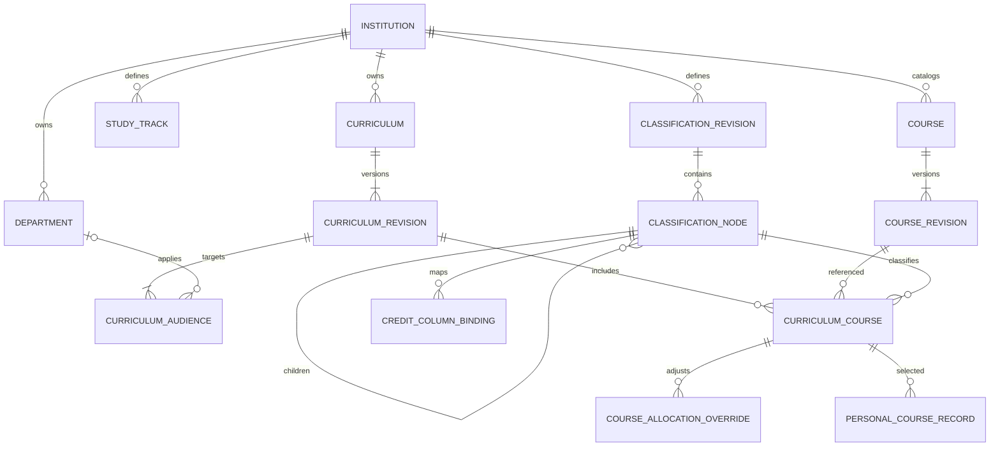

# 학교·학과·교육과정·과목·분류 통합 재설계안

> 구현 전 설계안이다. 실제 관리자 세 메뉴의 저장 구조와 API는
> [현재 구현](api/admin-academic-workspace.md)을 따른다. 학생 연결은 후속 단계다.

- 작성: 2026-11-08 KST. 검토용 논리 설계이며 현재 DB·OpenAPI·운영 서버를 변경하지 않는다.
- 사용자 범위 확장: 졸업요건뿐 아니라 학교·학과·교육과정·과목과 학교별 교육과정 분류를 함께 재설계한다.
- 목표: 학교가 등록한 이수구분을 과목·학점표·학생 화면이 같은 ID로 사용하고, 미연결 초안과 고정 이수구분의 이중 입력을 해소한다.
- 선행 조사: 현재 공유 체크아웃 b765272의 모델·schema·편집기와 저장소 `docs/api/openapi.json`. 실행 서버 호출·운영 DB 조회는 하지 않았다.
- 이 문서의 엔터티·상태·필드는 제안이다. 사용자 요청으로 이번 전체 작업에 DB·OpenAPI 변경까지 포함한다. 현재 단계는 구현 전 설계이며 학생 화면·다른 채팅의 변경은 보존한다.
- 구체 테이블·컬럼·키와 제안 API·이전 절차는 [DB·API 변경 명세](academic-schema-api-proposal.md)를 따른다. 이 논리 개요보다 구체 명세의 선택 사항이 우선한다.
- 현재 범위는 관리자 학교·학과/교육과정·과목/졸업요건 세 메뉴와 필요한 DB·백엔드·관리자 API다. 학생 수신·프로필·수강·O/X·기록 연결은 이번에 구현하지 않는다. 아래 학생 관련 흐름/수용 기준은 후속 참고이며 현재 완료 조건은 관리자 작성→저장→새 세션 재조회→수정·게시/철회다.
- 졸업 본문·학생 체크 상세는 [졸업요건 설계](graduation-requirements-data-design.md)를 따른다. 학교 기준과 분류 관계는 이 문서를 단일 설계 기준으로 삼는다.

## 1. 현재 분리가 생긴 이유

| 현재 구조 | 확인된 계약·구현 | 문제 |
| --- | --- | --- |
| 학교·학과 | institutions/departments CRUD, 학과는 학교+code로 유일 | 자체 API가 없는 영역은 아님. 이름 변경과 학과 개편 시 과거 자료 연결 정책 점검 필요 |
| 교육과정 | 학교·학과·이름·적용 연도, 학과 필수 | 교육과정 연도와 학생 입학연도 범위가 구분되지 않음. 학교 공통·다학과 기준을 직접 담기 어려움 |
| 과목 | 학교·code·이름·학점 | 과목 기본 정보와 교육과정에서 인정하는 역할이 별개임 |
| 교육과정 과목 | curriculum_id+course_id, category=major/general/other, required=boolean | 학교가 직접 만든 이수구분 ID를 받을 수 없음 |
| 학교별 교육과정 분류 | SchoolClassificationDrafts의 category/subcategory/requirement/track | 메모리 초안·임시저장만 있음. 현재 OpenAPI에 분류 마스터 CRUD·학생 목록 조회 없음 |
| 학생 수강 | personal_course_records의 category 문자열·과목 코드·학점 | 원본 교육과정 과목/분류 참조 없이 복사값을 보관. 이름만으로 안정 대응 불가 |
| 과목 등록 UI | AdminCourseRegistration이 과목 저장 뒤 교육과정 연결을 순차 호출 | 한 폼이지만 저장은 두 단계. 연결만 실패한 경우를 처리하나 서버 원자성/멱등성은 별도 과제 |

따라서 학교 분류에서 만든 '전공'이 과목 이수구분 목록으로 전달되지 않는 것은 단순 UI 중복이 아니라 저장 계약의 분리다. 과목·학과·교육과정 API 전체가 없다는 뜻은 아니다.

## 2. 추천하는 업무 흐름

1. 학교를 선택하고 학과와 학교별 이수구분·세부분류·이수 경로를 등록한다.
2. 교육과정의 이름·기준 연도·적용 대상을 정한다. 학교 공통과 학과별 교육과정을 구분한다.
3. 교육과정에서 기존 과목을 선택하거나 새 과목을 만들고, 그 교육과정의 이수구분·세부분류·필수/선택을 한 번 지정한다.
4. 학점표는 같은 분류 ID를 열에 연결하고, 졸업요건은 같은 적용 대상·분류를 참조한다.
5. 게시된 교육과정의 과목을 학생이 선택하면 원본·분류·기준 버전을 함께 반환하고 저장한다. 학생에게 이미 결정된 분류를 재입력받지 않는다.

관리자는 별도의 '과목 연결 이름'이나 내부 분류 코드를 필수 입력하지 않는다. DB에서 과목과 교육과정 관계를 분리하는 것은 유효하지만 UI에서는 한 작업으로 제공한다.
학교 등록→기준 작성→학생 재조회까지가 완료 기준이다. 임시저장 성공을 학생 기준 반영으로 표시하지 않는다.

## 3. 목표 관계

## 4. 엔터티별 책임과 제약

| 논리 엔터티 | 주요 값·관계 | 설계 원칙 |
| --- | --- | --- |
| Institution | 기존 id, name, 표시 정보·사용 상태·version | 학교 ID 재사용. 동명 학교를 이름으로 병합하지 않음 |
| Department | 기존 id, institution_id, name, 공식 code·상태·version | 학과 이름과 정체성 분리. 단순 개명은 같은 ID, 통폐합은 신규 ID+명시 승계 관계 검토 |
| ClassificationRevision | id, institution_id, lineage_id, revision, status, lock_version | 학교 분류 기준의 불변 게시 버전. 교육과정별 참조 버전을 고정 |
| ClassificationNode | id, revision_id, logical_id, parent_id?, label, position, state | 이수구분/세부분류 계층. 이름은 자유, 식별자는 서버 생성. 동일 학교·revision 부모, 순환 금지 |
| StudyTrack | id, institution_id, name, version, state | 단일전공/복수전공 같은 학교별 이수 경로. 과목 분류 트리와 별개의 대상 축 |
| Curriculum | id, institution_id, lineage_id, name | 교육과정의 안정 정체성. 하나의 학교 소속, 여러 개정본 가능 |
| CurriculumRevision | id, curriculum_id, revision, curriculum_year, classification_revision_id, status, lock_version | 교육과정 기준 연도와 학생 입학연도 구간을 분리. 한 버전은 명시한 학교 분류 버전 사용 |
| CurriculumAudience | id, curriculum_revision_id, department_id?, admission_from/to?, track_mode, track_refs | 학교 공통/학과별 적용 대상을 공통 scope 의미로 표현. 동일 차원 AND, 행끼리 OR |
| Course | 기존 id, institution_id, 공식 code, 상태 | 학교의 과목 정체성. 학교/공식 과목 코드 유일성은 기존 계약을 유지하고 코드 없는 과목 허용은 후속 결정 |
| CourseRevision | id, course_id, revision, name, 기본 학점, 설명 | 과목 개명·학점 개정 전후의 원본을 보존. 물리적으로 기존 version+스냅샷을 쓸지 별도 테이블을 둘지는 협의 |
| CurriculumCourse | id, curriculum_revision_id, course_revision_id, classification_node_id, requirement, 인정학점, position | '이 교육과정에서 이 과목을 어떻게 인정하는가'의 기준. 이수구분의 주 저장 위치 |
| CourseAllocationOverride | id, curriculum_course_id, 적용 경로/대상, classification_node_id?, requirement?, 인정학점? | 경로별 차이가 실제 있는 경우에만 예외 설정. 기본값을 복제 입력하지 않음 |

- 표의 단복수 이름과 상태명은 제안이다. 기존 테이블 전체를 새로 만들거나 삭제하겠다는 확정안이 아니다.
- CurriculumAudience는 졸업 설계 ScopeClause와 같은 판별 의미를 공유한다. 물리적으로 공통 컴포넌트를 쓰거나 전용 FK 테이블을 사용하되 서로 다른 규칙으로 구현하지 않는다.
- 학교 공통 교육과정은 department_id가 없는 audience, 여러 학과의 공동 교육과정은 여러 audience로 표현할 수 있다. 사용자의 주전공·복수전공별 적용 문맥은 명시하며 기존 단일 curriculum_id 프로필과의 호환 계약이 필요하다.
- 학점표·인증·한 줄 요건이 교육과정 revision을 참조할 때 학생 조회에서 같은 기준을 선택해야 한다. 교육과정에 속하지 않는 학교 공통 규정도 허용하고 누락시키지 않는다.
- CurriculumCourse의 동일 (curriculum_revision_id, course_id)는 원칙적으로 한 기본 연결이다. 같은 과목의 교차 인정은 원본 과목을 복제하지 않고 별도 산입 정책으로 처리한다.
- 기본 분류는 과목 마스터에 별도로 필수 저장하지 않는다. 기존 과목이 다른 교육과정에서 전공/교양으로 다르게 인정될 수 있기 때문이다. 등록 편의를 위한 추천값이 필요하면 추천으로만 표시하고 확정된 교육과정 분류를 우선한다.
- 기본 requirement는 required/elective/not_specified의 닫힌 의미를 제안한다. 학교마다 필수·선택 마스터를 새로 등록하지 않는다. 미입력을 선택(false)으로 자동 변경하지 않으며 not_specified는 학교 규정이 구분하지 않는다는 명시 상태다.
- Override는 같은 대상을 두 행이 동시에 덮지 않도록 게시 시 검증한다. 자동 우선순위나 마지막 행 선택은 사용하지 않는다. 미입력 override 값은 기본값 상속, 명시 초기화와 구별한다.

## 5. 하나의 분류를 공유하는 방법

- 분류 트리에서 세부분류를 고르면 상위 이수구분은 경로로 결정된다. 부모 ID와 자식 ID를 사용자에게 각각 재입력받지 않는다.
- 분류의 이름은 어느 깊이에서도 자유롭다. 전공/교양이라는 이름 자체를 코드 조건으로 삼지 않는다. 기존 고정 enum은 호환 단계에서만 명시 매핑을 둔다.
- 과목·학생 수강·학점표는 같은 classification node의 안정 logical_id와 구체 revision을 참조한다. 새 이름을 저장해도 과거 게시본의 표시와 판정이 바뀌지 않는다.
- 새 분류 revision에서는 변하지 않은 항목의 logical_id를 보존한다. 항목 의미·상위 이동이 바뀌면 영향을 검토하고 교육과정을 새 revision으로 전환한다. ID 이름 맞추기 자동 승계는 금지한다.
- 학점표의 표 머리글 구조와 분류 트리는 다를 수 있다. '교양→필수→기초교양' 중 필수는 requirement 조건, 기초교양은 분류 참조다. 이를 표시 트리와 완전히 동일한 마스터로 강제하지 않는다.
- 학점표 잎 열은 `분류 subtree + 필수/선택 조건`으로 집계 대상을 지정한다. 서로 겹치는 열이 있어도 중복 인정 허용은 별도 명시 정책이다.
- 이수 경로는 대상 선택과 경로별 인정 기준에 쓴다. 학생 국적·편입 여부·재직 여부를 모두 이수 경로 값으로 섞는 것은 범용성을 해친다. 추가 대상 속성 계약을 별도로 정하고 미지원 사례를 드러낸다.
- 사용 중인 분류·경로는 삭제하지 않고 사용 중지한다. 신규 선택은 막되 기존 게시본·수강·감사 표시와 참조는 보존한다.

## 6. 후속 참고: 학생 수강과의 연결 계약 — 이번 범위 제외

- 학교 기준에서 선택한 수강은 원본 curriculum_course_id와 그 revision, course_revision_id, 적용 문맥·기준 버전을 저장한다. 분류 이름이나 course_code만으로 재연결하지 않는다.
- 학생 직접 입력 수강은 원본 참조가 없는 별도 출처로 유지한다. 이름이 비슷하다는 이유로 학교 기준 과목으로 자동 승격하지 않는다.
- 원본과 학생의 실제 수강 학기·성적·취득 학점은 구분한다. 기준 학점이 바뀌어도 과거 학생 기록을 덮어쓰지 않는다. 재수강·학점 교류·대체 인정·복수전공 중복 산입은 별도 정책이다.
- 학교 기준을 조회할 때 선택 가능한 분류·경로를 함께 조회할 수 있어야 한다. 본인 프로필은 원본 ID를 보존하고 화면은 표시 이름을 받는다. UUID를 기존 track 문자열에 임의로 넣지 않는다.
- 주전공·복수전공 기준을 동시에 사용할 때는 본인 학업 문맥 여러 개를 저장하는 구조를 검토한다. 어느 교육과정/경로의 인정인지 기록 연결에 명시하고 임의의 첫 연결을 사용하지 않는다.
- 프로필 문맥과 학교 승인 기록은 별개다. 학생 자기 입력·자기 체크는 기존 공식 감사의 학교 검토 입력으로 대체하지 않는다. 학생 UI 구현은 관리자 구조 이후다.

## 7. DB 무결성·버전·동시 저장

- 학교·학과·과목의 기존 ID와 학교 복합 FK를 유지한다. 분류/경로/교육과정/표 연결도 같은 학교인지 DB와 서버에서 검증한다.
- ClassificationNode는 같은 revision의 부모만 참조하고 (revision_id, logical_id)는 UNIQUE다. position 순서는 같은 부모 안에서 유일하며 root NULL 처리도 포함한다.
- CurriculumCourse가 참조하는 분류는 CurriculumRevision에 고정된 classification revision의 항목이어야 한다. 다른 학교·다른 revision을 몰래 섞지 않는다.
- 교육과정 게시본은 본문 과목·분류·적용 대상과 참조 버전을 함께 고정한다. 게시 후 변경은 새 revision으로 하고 과거 학생 기록·감사에 역전파하지 않는다.
- 범위가 중복되는 현재 교육과정 revision의 선택 규칙과 교체 관계를 정의한다. 다른 교육과정의 적용 가능성은 중복 오류와 구별하고 학생 문맥으로 명시 선택한다.
- 학과 개편과 학교명 변경 시 기존 규정·과목·학생 문맥의 연결을 보존한다. 학과 ID의 학교 이동은 허용하지 않는다. 실제 통합 대학 같은 학교 경계 변경은 별도 운영 이전이다.
- 새 과목 생성+교육과정 편입을 한 번에 제공하는 서버 동작은 트랜잭션·멱등성 키·본문 지문·원본 버전 검사를 갖춰야 한다. 응답 유실 뒤 동일 키로 결과 조회/복구가 가능해야 한다.
- 기존 두 API 호출 경로를 유지하는 동안에는 과목 저장 성공/연결 실패를 보존하고 연결만 재시도한다. 현재 FE가 원자적 저장을 보장한다고 문서화하지 않는다.
- 학교별 분류 관리 권한은 기존 학교 범위 관리자를 따른다. 학생은 게시 기준만 조회하고 개인 기록은 본인만 수정한다. 관리자가 분류를 편집할 수 있다는 이유로 학생 개인 기록을 열람하지 않는다.

## 8. 필요한 API 능력과 이전

새 API URL·DTO는 확정하지 않는다. 기존 공통 오류·field_errors·request_id·expected_version·페이지네이션을 유지하며 다음 동작이 필요하다.

| 동작 | 현재 상태 | 필요한 확장 |
| --- | --- | --- |
| 학교·학과 관리 | 기존 API 있음 | 개편/사용 중지·기존 참조 보존·버전 정책 정리 |
| 학교별 분류·경로 저장/학생 조회 | 저장소 OpenAPI 없음 | 안정 ID·계층·revision·사용 상태·권한·필드 오류·재조회 |
| 교육과정 관리 | 기존 학교+단일학과+연도 CRUD | 버전/게시·입학연도 범위·공통/다학과 대상·분류 기준 참조 |
| 과목/교육과정 과목 관리 | 기존 API·고정 category/required | 동일 분류 ID·버전 반환/저장·경로별 예외·인정 기준·단계 저장 복구 |
| 학생 프로필/수강 | 기존 API·track 문자열·복사 분류 | 원본 연결 ID·복수 문맥·분류/경로 ID·실제 적용 기준을 재조회 |
| 졸업 본문 | 한 줄 일부 연결, 표/인증 저장 없음 | 이 문서의 교육과정·분류를 공유하는 저장·게시·학생 조회 |

이전 순서:

1. 기존 학교·학과·과목·교육과정 ID를 재사용할 대응표와 기준 스냅샷을 준비한다. 자동 대량 삭제/재생성은 하지 않는다.
2. 학교별 분류·경로 마스터와 초안 저장/재조회를 먼저 확정한다. 기존 기기 초안은 사용자 동의 이전 후보이며 서버 공식 기준으로 자동 게시하지 않는다.
3. 고정 major/general/other와 새 학교 분류의 명시 매핑을 학교별로 확인한다. 일대일 대응이 없으면 확인 필요로 남긴다. 이름 '전공'만 보고 합치지 않는다.
4. 교육과정 과목의 기존 category/required를 새 참조와 함께 읽는 호환 기간을 둔다. 쓰기 진실은 하나로 정하고 양쪽 불일치 시 조용히 우선순위를 정하지 않는다. 호환 필드 반환 가능 여부는 서버에서 확정한다.
5. 기존 수강의 원본 미상값은 보존한다. 과목 코드/이름으로 억지 연결하지 않으며 확정할 수 있는 항목만 명시 연결한다.
6. 관리자 저장→학생 기준 조회→수강 재조회→학점표 연결을 확인한 뒤 새 경로를 전환한다. 롤백 시 구버전·기존 감사·개인 기록을 읽을 수 있어야 한다.

## 9. 수용 기준과 실행 순서

- 학교 A가 만든 전공/교양/추가 분류가 A의 과목 편집 선택지와 학생 조회에 같은 ID로 나온다. 학교 B의 동명 분류와 섞이지 않는다.
- 세부분류 선택 시 부모 이수구분이 자동 결정되고 과목에 같은 분류를 두 번 입력하지 않는다. 이름 변경 후에도 원본 참조와 과거 표시는 유지된다.
- 동일 과목이 교육과정 A에서 전공 필수, B에서 교양 선택이어도 마스터 과목은 중복 생성되지 않고 기준은 독립 보존된다.
- 같은 교육과정의 경로별 인정 차이는 겹치지 않는 override로 표현한다. 해당 학생의 실제 적용 분류가 서버에서 명확히 반환된다.
- 교양 공통 교육과정을 특정 학과에 억지 소속시키지 않으며, 교육과정 연도와 입학연도 구간을 구분한다.
- 저장 응답 유실·연결 실패·버전 충돌·권한 회수·분류 사용 중지 후에도 입력과 기존 저장 결과를 보존하고 안전하게 재조회한다.
- 학생 수강의 원본을 다시 읽을 수 있고 학점표 열은 같은 분류를 참조한다. 직접 입력·미확인 자료로 공식 판정을 만들지 않는다.

현재 실행 순서는 **학교·학과 → 교육과정·과목 → 졸업요건**이며 공통 분류·범위·버전의 DB와 관리자 API를 함께 정리한다. 학생 수신 API·데이터·화면은 관리자 세 메뉴 완료 후 별도 단계다. 이전의 '한 줄 요건부터 구현' 계획보다 공통 기준 설계를 먼저 확정한다.

이번 검증은 코드·schema·저장소 OpenAPI 대조와 문서 무결성 확인이다. 실행 서버에 API가 배포됐는지, 운영 DB의 현재 레코드/마이그레이션 상태는 확인하지 않았다. 담당자에게 메시지를 보내거나 DB·API·Flutter 코드를 변경하지 않았다.
