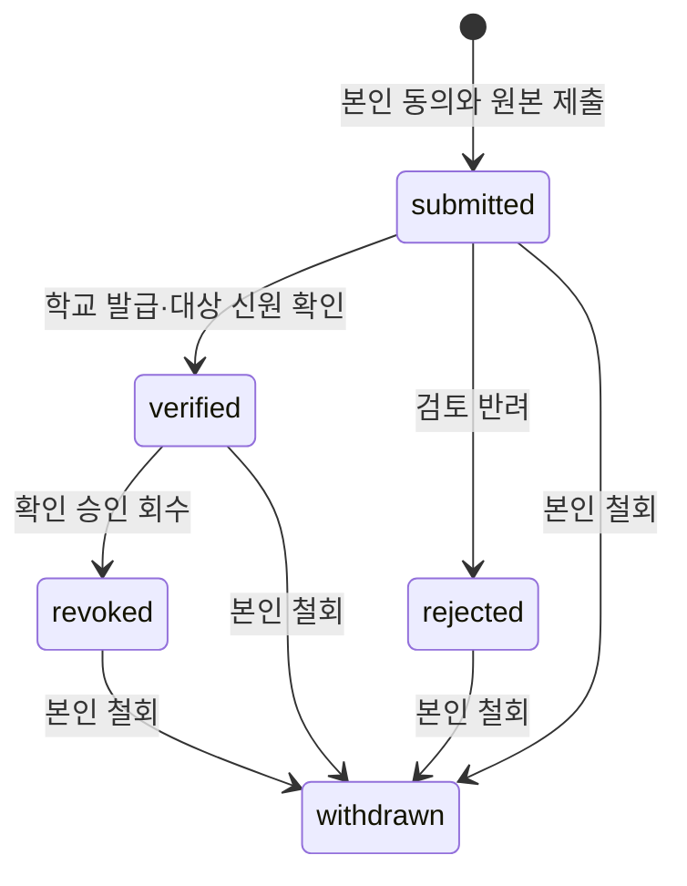

# 학교 발급 자료 원본 제출·검토 API

학교 발급 파일을 관리자가 검토한 뒤 등록하는 방식의 첫 단계다. 로그인한 본인이 PDF를
제출하고 해당 학교의 관리자가 발급기관과 대상자의 신원을 확인한다. 원본 확인은 정규화된
성적·봉사·자격 기록의 승인이나 졸업 판정이 아니다. 응답의 `graduation_eligible`은 항상
`false`다. 기록별 페이지 매핑·문맥·완전성 검토와 별도 승인은
[학교 검토 기록 API](official-student-records.md)를 따른다. 학교별 성적 환산·재수강 정책의
자동 해석은 제공하지 않으며 판정은 [졸업감사 API](graduation-audits.md)를 따른다.
학교 SSO, OCR, 외부 스토리지·LLM 공급자를 도입하지 않는다.

## 원본과 접근 범위

- `/api/v1/me/official-record-sources`는 본인 제출 자료만 제공한다. 다른 소유자의 UUID는
  404다. 관리자 역할만으로 이 경로에서 다른 학생의 자료를 읽을 수 없다.
- 제출에는 학교 UUID와 `review_consent_confirmed=true`가 필요하다. 이 동작은 선택한
  학교의 범위를 가진 관리자가 **이 제출 원본과 검토 이력**을 확인하도록 허용한다.
  기존 개인 수강·봉사·포트폴리오 등 다른 기록의 열람 권한을 주지 않는다.
- `/api/v1/admin/official-record-sources`는 슈퍼관리자와 활성 학교 범위가 있는 학교 관리자만
  접근한다. 학교가 삭제 표시되거나 범위가 회수되면 접근을 차단한다. 철회된 자료는 목록,
  원본, 상세, 이력 모두 관리자에게 보이지 않는다. 본인에게는 원본과 이력이 남는다.
- 학생의 파일 선택이나 이름·이메일은 공식 학적 증명이 아니다. 검토자는 별도 학교 확인을
  거쳐 발급기관과 제출자 일치를 확인한다. 검토자는 자신의 원본을 직접 확인 승인할 수 없다.

## 제출·재시도

`POST /api/v1/me/official-record-sources`의 본문은 원본 PDF 바이너리이고
`Content-Type: application/pdf`다. multipart나 Base64 JSON으로 변환하지 않는다.
다음 메타데이터를 UTF-8 JSON으로 직렬화한 뒤 Base64url로 인코딩해
`X-Unipath-Source-Metadata` 헤더로 보낸다(최대 4,096자). 파일명·발급일을 URL/query에
넣지 않는다. 이 인코딩은 암호화가 아니므로 HTTPS·서버 인증을 그대로 적용한다.
OpenAPI는 binary requestBody와 헤더의 내부 JSON 스키마를 명시한다.

| 필드 | 의미 |
|---|---|
| `client_id` | 이번 제출의 클라이언트 UUID. 결과 불명·재시도에도 동일하게 유지 |
| `institution_id` | 검토를 요청할 등록 학교 UUID |
| `department_id`, `curriculum_id` | 선택한 등록 학과·교육과정 UUID. 다른 학교/학과 조합은 거부 |
| `document_kind` | `transcript`, `volunteer`, `certificate`, `thesis`, `other` |
| `issued_on` | 발급일 `YYYY-MM-DD`. 서버 UTC 오늘 이후는 거부 |
| `filename` | PDF 파일명. 최대 128자, 경로·제어 문자·다른 확장자는 거부 |
| `review_consent_confirmed` | 선택 학교 관리자의 원본 검토에 대한 본인 확인. JSON boolean true |

원본은 최대 **2 MiB**다. Content-Length와 실제 스트림 크기를 각각 검사하고, PDF signature와
EOF를 검사한다. 이는 파일 형식의 제한된 검사이며 유효한 모든 PDF 구조·발급 진위를
자동 검증한다는 뜻이 아니다. PDF 스크립트·OCR·파싱을 실행하지 않는다.
로그인 사용자당 업로드 시도는 15분에 20회이며, 본인 자료는 보관 중인 철회본까지 합쳐
최대 40개·32 MiB다. 실패 시 원본/이력 일부만 생성하지 않는다.

동일 소유자·`client_id`·정규화된 메타데이터·원본 SHA-256은 기존 자료를 반환한다(201).
같은 키로 다른 메타데이터나 파일을 전송하면 409다. 철회 후 재시도해도 철회를 되돌리거나
새 검토 이벤트를 생성하지 않는다. 클라이언트는 자동으로 새 ID를 만들거나 재전송하지 않는다.
소유자·수행자·상태·버전·해시는 서버에서 결정하며 역할/승인 플래그를 받지 않는다.

## 조회와 검토

두 prefix는 `/api/v1/me/official-record-sources`, `/api/v1/admin/official-record-sources`다.

| 메서드·경로 | 동작 |
|---|---|
| `GET {prefix}` | 본인 또는 허용 학교 목록. `institution_id`, `status`, UUID `cursor`, `limit(1..100)` |
| `GET {prefix}/{id}` | 메타데이터·상태·버전·원본 SHA-256·크기. 파일 본문/이메일/이름 제외 |
| `GET {prefix}/{id}/file` | 인증된 원본 다운로드. `application/octet-stream`, attachment, no-store, nosniff |
| `GET {prefix}/{id}/events` | 버전순 검토/철회 이력. 자유 입력 사유는 이 보호 경로에서만 제공 |
| `POST /me/official-record-sources/{id}/withdraw` | 본인이 검토 허용을 철회. `expected_version` |
| `POST /admin/official-record-sources/{id}/verify` | 제출본의 발급기관/대상 신원 확인 |
| `POST /admin/official-record-sources/{id}/reject` | 제출본 반려. `expected_version`, 비어 있지 않은 `reason` |
| `POST /admin/official-record-sources/{id}/revoke` | 확인 승인 회수. `expected_version`, `reason` |

확인 승인은 `expected_version`, `expected_sha256`, `school_issued_confirmed=true`,
`subject_identity_confirmed=true`를 모두 요구한다. 검토 전후 원본 해시를 바꿀 수 없고 승인 시
실제 원본을 다시 해시한다. 무결성 오류는 503이며 원본을 반환하거나 승인하지 않는다.
버전 불일치·허용되지 않는 상태 전이는 409다. 모든 변경은 현재 세션·역할·학교 범위를
신원 잠금 안에서 재확인하고 하나의 트랜잭션으로 원본 상태와 이벤트를 기록한다.

확인·반려·회수·철회 후 원본을 수정하거나 다시 승인하지 않는다. 새 원본은 별도 제출로
등록한다. 삭제·보관 기간과 자동 정리 정책은 후속이며 원본/검토 이력을 자동 삭제하지 않는다.
다운로드는 캐시하지 않으며 일반 감사에는 행동·대상·학교·수행자·request_id만 남긴다.
파일명·발급일·PDF·검토 사유는 일반 로그나 공용 감사에 복제하지 않는다.
원본 경로는 양쪽 Nginx에서 접근 로그를 끄며 컨테이너·개발 Compose의 Uvicorn도 접근
로그를 사용하지 않는다. 호스트에서 직접 실행할 때도 `--no-access-log`를 사용한다.

## 보관·프론트 계약

원본은 `official_record_sources.file_data`의 PostgreSQL BYTEA로 보관한다. 파일은 작고
용량이 제한된 MVP 자료이며 컨테이너 파일시스템·공용 RAG·외부 모델에 저장하지 않는다.
원본과 검토 이벤트는 DB 백업·복원 범위에 포함된다. 향후 큰 파일 보관 공급자를 도입하면
별도 어댑터와 DB/파일 일관성·보관 정책을 함께 정한다.

Flutter의 `RecordSourceApi`와 `RecordSourceUpload/RecordSource/RecordSourceEvent`는
명시적인 wire 계약을 제공한다. `RecordSourceApi.forOwner(auth, id)`는 `AuthApi`의 JSON·파일
capability를 같은 로그인에서 캡처하며 쿠키/메모리 bearer와 `X-Unipath-Owner`를 공유한다.
본인 조회 응답이 다른 소유자이거나 단건 응답 ID가 다른 경우 사용하지 않는다. 업로드·다운로드
도중 다른 계정이나 같은 계정의 새 로그인이 생기면 이전 capability의 응답을 버린다.
PDF·인증 토큰은 이 adapter에서 디스크/환경설정에 보관하지 않는다.
[제출·검토 화면](../frontend/features/official-records.md)에서 기존 계약을 사용한다.
