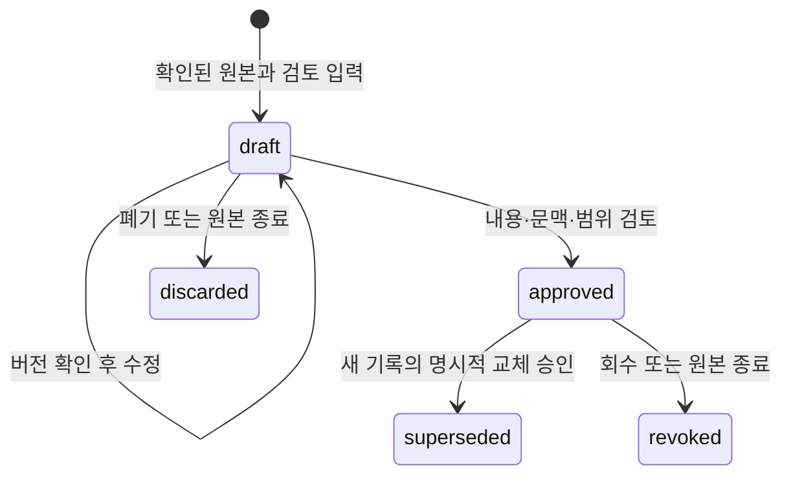

# 학교 검토 기록 API

[학교 발급 원본](official-record-sources.md)의 발급기관·대상 신원 확인 이후, 관리자가
원본을 읽고 성적·봉사·자격·논문 기록과 적용 문맥을 직접 입력·검토한다. 개인 입력 자료나
학업 프로필을 공식 기록으로 자동 이전하지 않는다. OCR·성적 환산·재수강 정책을 추정하지 않는다.
이 API는 기록 검토까지 제공한다. 계산은 별도 [졸업요건 감사 API](graduation-audits.md)를 따르며
제출·검토 화면은 후속이다. 이 경로의
`graduation_eligible`은 항상 `false`다.

## 접근과 경로

`/api/v1/admin/official-record-batches`는 슈퍼관리자 또는 활성 학교 범위의 관리자,
`/api/v1/me/official-record-batches`는 로그인한 본인의 승인 이력만 제공한다.
소유자는 확인된 원본에서 서버가 결정한다. 요청의 `owner_id`는 허용하지 않는다.
관리자의 초안·승인되지 않은 폐기본은 학생에게 보이지 않는다. 다른 학생의 UUID는 404다.
관리 범위 회수·학교 삭제 표시·원본 철회는 관리자 접근을 즉시 종료한다.

| 메서드·경로 | 계약 |
|---|---|
| `GET {prefix}` | 메타데이터 목록. `source_id`, `institution_id`, `kind`, `status`, UUID `cursor`, `limit(1..50, 기본 20)` |
| `GET {prefix}/{id}` | 기록·페이지·검토 문맥·과목/자격 마스터 스냅샷·현재 사용 가능 여부 |
| `GET {prefix}/{id}/events` | 버전순 검토 이력. 사유는 이 보호 경로에서만 조회 |
| `POST /admin/official-record-batches` | 확인된 원본에 초안 생성(201) |
| `PUT /admin/official-record-batches/{id}` | 같은 종류의 초안 전체 교체. `expected_version`, `data` |
| `POST /admin/official-record-batches/{id}/approve` | 명시적 검토와 원본 해시·버전 확인 후 승인 |
| `POST /admin/official-record-batches/{id}/revoke` | 승인 회수. `expected_version`, 비어 있지 않은 `reason` |
| `POST /admin/official-record-batches/{id}/discard` | 초안 폐기. 동일 버전·사유 계약 |

초안 생성은 `source_id`, `expected_source_version`, 재시도 UUID `client_id`, `data`를 받는다.
확인된 원본과 현재 관리 권한이 유지되고 본인/client_id·최초 정규화 요청 지문이 같으면
현재 상태의 기존 기록을 반환한다. 원본 철회 후에는 재시도로도 관리자 접근이 열리지 않는다. 숫자의
동일한 표현(`3.5000`, `3.5`)은 같은 지문이다. 다른 내용은 409이며 폐기/회수 기록을
재시도로 되살리지 않는다. 원본·기록 종류마다 초안 하나를 유지한다.
승인 후 내용을 수정하거나 삭제하는 경로는 없다.
모든 쓰기는 현재 신원·세션·학교 범위를 잠금 안에서 재확인하고 이벤트·감사와 함께 커밋한다.

## 입력과 누락 정보

`data`의 공통 필드는 `kind`, `page_count(1..500)`, `records_as_of(YYYY-MM-DD)`,
`coverage(complete|partial)`, `context`, `records(최대 500건)`다. 기준일은 원본 발급일을
넘을 수 없다. 기록마다 고유 `client_id`와 범위 안의 `source_page`가 필요하다.
JSON 계약은 [OpenAPI](openapi.json)가 기준이다. 본문은 최대 256 KiB,
소유자당 보관 초안·과거 이력을 합해 최대 200묶음이다.
원본·학교 검토 기록 경로는 양쪽 Nginx에서 접근 로그를 끈다. 검토 내용·사유는
보호된 기록/이력에만 저장하며 일반 감사에는 행동·학교·대상·수행자·request_id만 남긴다.

| 종류 | 검토한 입력 |
|---|---|
| `academics` | 같은 학교 `course_id`·`expected_course_version`, 이수 상태, 취득 학점, 분류, 원문 성적. 숫자 평점은 명시적 `grade_points`·`grade_scale` 쌍일 때만 입력 |
| `volunteers` | 승인 상태와 `approved_hours`. 확인되지 않은 시간은 null |
| `certificates` | 활성 `certificate_id`·`expected_certificate_version`, 승인 상태, `expires_on`, `validity_known`. 유효기간 미확인은 무기한 자격으로 간주하지 않음 |
| `theses` | 유형, 승인 상태, 필수 nullable `is_completed`, 성적. 완료 여부 미확인은 null |

금액·학점·시간은 유한하고 0 이상인 최대 6자리 소수의 Decimal이며, wire에서는 문자열이다.
기록이 없는 완전한 자료의 `records: []`와 일부만 검토한 `coverage: partial`은 다르다.
과목별 시도는 그대로 보존하며 재수강을 임의로 합산/제외하거나 문자 성적을 평점으로 바꾸지 않는다.

`context`의 학과·교육과정 UUID는 원본의 학교에 속해야 한다. 입학연도·이수경로도 관리자가
검토해 입력한다. 초안은 미완성 문맥을 허용하지만 승인에는 학과·입학연도·이수경로가
필요하다. 교육과정은 선택하지 않은 경우 null로 고정해 별도 문맥으로 취급한다.
자유 입력 개인 프로필을 부족한 문맥의 대체값으로 쓰지 않는다.

## 승인·원본 철회·교체

승인에는 `expected_version`, `expected_source_sha256`, 각각 boolean true인
`records_reviewed`, `context_reviewed`, `coverage_reviewed`가 필요하다. 검토자는 자신의
기록을 승인할 수 없다. 승인 시 실제 원본 SHA-256과 고정한 과목/자격·발급처 버전을
재확인한다. 오래된 버전·변경된 참조·불완전 문맥은 409다.

소유자·학교·학과·교육과정(null 포함)·입학연도·이수경로·종류마다 현재 승인은 하나다.
기존 승인을 바꾸려면 새 초안을 만들고 승인 시 `replaces_batch_id`와
`expected_replaced_version`을 모두 지정한다. 이전 기록은 `superseded`로 보존한다.
부분 자료도 검토한 범위를 명시해 승인할 수 있지만 계산 입력으로는 사용할 수 없다.

원본 회수·본인 철회는 같은 트랜잭션에서 연결된 초안을 폐기하고 승인을 회수한다.
철회 후 학생에게는 이미 승인한 기록·원본·이력이 남지만 관리자 열람은 종료한다.
관련 학과·교육과정·과목 물리 삭제는 차단하며 참조 조회에는 내용·학생·건수 대신
`protected_reference` 하나만 표시한다. 자격·발급처 비활성화나 마스터 버전 변경은
과거 값을 지우지 않고 `reference_changed`로 표시한다.

## 계산 연결과 프론트 계약

`usable_for_audit`는 기록의 현재 사용 조건만 뜻한다. 원본 확인 상태/버전/실제 해시,
마스터, 전체 문맥, 완전한 검토 범위를 모두 확인한다. `issues`가 있으면 사용하지 않는다.
기록 JSON 지문·종류·문맥·참조 대응이 손상되면 상세 값을 노출하지 않고 공통 503이다.

내부 `owned_snapshot`은 로그인한 본인과 정확히 일치하는 문맥·기준일의 현재 승인만
Rule Engine 입력으로 만든다. 미등록·부분 검토·다른 기준일·변경된 원본/마스터는
알 수 없는 입력(null)이며 완전하게 확인한 빈 자료만 빈 배열이다. 과거 승인·다른 문맥을
최신 입력으로 임의 선택하지 않는다. [졸업요건 감사](graduation-audits.md)는 전체 규정의
별도 검토와 필요한 본인 기록 종류만 연결하고 불변 결과·입력·페이지 대응을 보관한다.

Flutter `OfficialRecordsApi.forOwner(auth, id, admin: ...)`와 생성한 `SchoolRecord*` DTO는
현재 로그인에 묶인 JSON 전송을 사용한다. 계정 변경이나 같은 계정의 새 로그인 이후
이전 응답을 버리고, 본인 조회의 소유자/단건 ID/이벤트 ID를 확인한다. 관리자 플래그는
클라이언트 경로 선택이며 서버 권한을 부여하지 않는다. 자동 재시도·로컬 보관·화면 전환은 없다.
모델 재생성: `backend` 환경에서 `python ../scripts/export_official_record_contracts.py` 실행 후
생성 Dart 파일에 `dart format`을 적용한다.
