# 시스템 아키텍처 관계도

UniversityPath AI는 1차 MVP의 Flutter Web과 3차 MVP 확장인 Windows
애플리케이션, 하나의 FastAPI 애플리케이션으로 구성한다.
FastAPI 내부는 기능별 모듈로 분리하되, MVP 단계에서는 마이크로서비스로 분리하지
않는다.

### 현재 개발환경 구현

`compose.yaml`은 하나의 FastAPI `api` 서비스, PostgreSQL 17/pgvector `db`
서비스와 시작 전 Alembic을 실행하는 일회성 `migrate` 서비스를 구성한다.
DB 준비 → 마이그레이션 성공 → API 시작 순서이며 도메인을 별도 서비스로 나누지 않는다.
호스트에서는 API 8010과 DB 5433을 사용하고 Docker 내부에서는 8000/5432를 사용한다.
`backend/app/`에는 API·스키마·DB·서비스·Rule Engine·RAG 경계를 마련했다.
아래 다이어그램의 도메인 기능과 외부 어댑터는 목표 구조이며 현재 기능 구현이 아니다.
현재 API는 상태/DB 준비 확인, `/auth/*` 계정·세션, `/admin/*` 계정·학교 범위 관리와
`/me/*` 개인 자료, `/catalog/*` 학생 학사 조회와
`POST /api/v1/assistant/queries`를 제공한다. 사용자·역할·세션은 PostgreSQL에 저장하고
Web은 HttpOnly 쿠키, Windows는 메모리 bearer 토큰을 사용한다. 보호 API는 DB의 현재
상태·역할·활성 학교 범위를 확인한다. 실제 관리자 로그인은 RemoteAdminRepository를 통해
학교·학과·교육과정·과목·규칙/문서 메타데이터·역할/범위·감사 API를 사용한다.
검토한 조건 설명은 실행 가능한 Rule Engine 조건으로 해석하지 않는다. 학교 질의의 공개 계약은 내부 RAG와 분리하고,
동기 검색은 FastAPI의 스레드풀에서 실행한다. 파일 인덱스는 앱 시작 시 한 번 읽는다.
기본 실행은 빈 인덱스이며 선택적 `compose.rag.yaml`은 PDF 추출 후 API에 읽기 전용
JSONL을 연결한다. 파일 코퍼스는 로컬 환경에서만 사용한다.
현재 PDF는 미승인이고 실제 생성기는 없으므로 공식 답변은 생성하지 않는다.
학생의 학교 발급 PDF는 공용 규정 RAG와 다른 [원본 제출·검토](api/official-record-sources.md)
경로로 처리한다. 본인이 선택한 학교의 원본 검토에 동의하면 제한된 PDF 스트림을 검사하고
PostgreSQL BYTEA에 보관한다. 해당 학교 관리자가 발급기관·대상 신원을 검토하며 변경은
현재 신원·학교 범위를 잠금 안에서 재확인한다. 원본 해시와 검토 이벤트는 DB 백업에 포함된다.
확인된 원본에는 별도 [학교 검토 기록 API](api/official-student-records.md)로 관리자가
페이지별 기록과 학적 문맥·검토 범위를 입력한다. 승인 후에는 내용을 고치지 않고 새 기록의
명시적 교체로 이력을 보존한다. 원본 철회·회수는 연결 초안·승인도 같은 트랜잭션에서 종료한다.
개인 입력 프로필을 공식 문맥으로 자동 승격하거나 외부 LLM으로 전송하지 않는다.

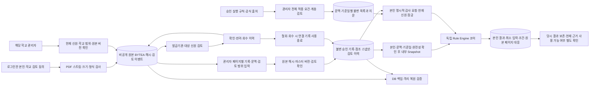
별도 인증 경로 `/me/school-searches`, `/me/school-queries`는 등록 UUID와 입학연도·이수경로를
검증하고 DB의 승인 문서만 조회한다. 기존 이름 기반 `/assistant/queries`와 자동으로 섞지 않는다.
학교 질의의 졸업 판정 요청은 계속 `rule_engine_required`로 안내한다. 별도 명시적
[졸업요건 감사 API](api/graduation-audits.md)는 학교·학과·교육과정·입학연도·이수경로와
기준일을 받아 전체 규정 검토 및 본인 학교 승인 기록만 코어에 전달한다. 질문 텍스트나
개인 프로필로 학적·기준일을 자동 확정하지 않는다.
`app/rules/`의 결정론적인 계산 코어는 DB·HTTP·LLM과 분리해 구현했다. 내부의 공식 규칙
계산과 개인 기준 계산을 구분한다. 개인 계산 API는 본인 DB 자료와 명시적 조건을 코어에
전달하며 불변 결과/입력 snapshot을 저장한다. 공식 자료 감사는 별도 DB 이력에
최소 입력·조건·결과·지문을 보존하고 재현 검증한다. 원본/규칙 회수 후에도 과거 값을
바꾸지 않고 상세 조회에서 현재 근거 사용 가능 여부를 확인한다. 관리자에게 타 학생의
감사 열람권을 주지 않으며 기존 개인 계산 API와 결과를 섞지 않는다.
`app/operations/db_backups.py`는 호스트에서 실행하는 읽기 전용 DB 백업·임시 DB 복구 검증
도구이며 애플리케이션 요청 경로에 포함하지 않는다.
현재 구현 흐름은 아래와 같다. 상세 API 계약은
[`api/assistant.md`](api/assistant.md), 실행 방법은
[`../backend/README.md`](../backend/README.md)를 따른다.

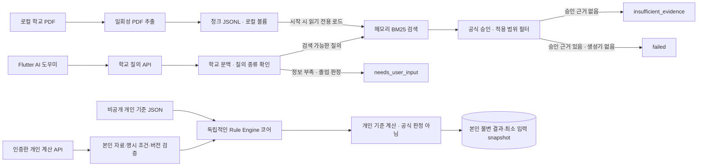

### 개인 자료 일괄 이전

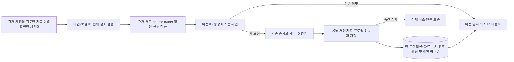

개별 CRUD와 같은 서비스 검증을 사용하되 커밋은 묶음 전체 마지막에 한 번만 한다.
이전은 기존 프로필을 덮어쓰지 않고 개인 자료를 학교 확정 기록으로 바꾸지 않는다.
프론트 타입/전송 adapter와 [이전 API](api/personal-imports.md)를 제공한다. [학업 프로필·일정 화면](api/planning-integration.md)은 동의·시간대 확인과 서버 저장소 전환을 연결했으며 [다른 개인 자료 10종](api/personal-workspace-integration.md)도 별도 서버 저장/동의 이전을 연결했다.

### 실제 관리자 저장 경로

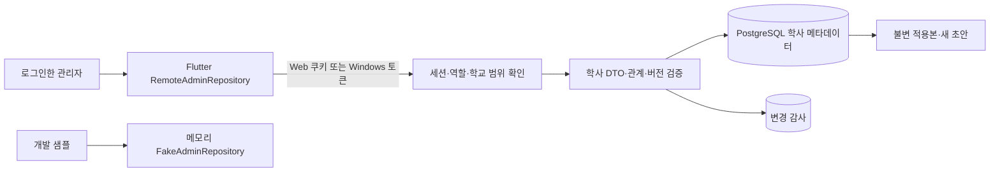

변경은 권한 변경과 같은 transaction lock에서 신원/세션을 재확인한다.
문서 메타데이터 등록/적용은 RAG 승인·임베딩·졸업 판정과 분리한다.
[학사 API](api/academic.md)에 입력·참조·버전 계약을 정의한다.

### 학교 지식 검토와 DB 검색

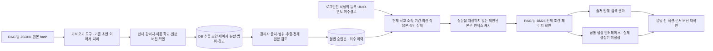

동일 문서의 본문을 요청마다 읽고 재인덱싱하지 않으며 캐시 키에 선택 범위·문서/학교 버전·날짜를
포함한다. 승인 회수·새 적용본이 나타나면 과거 근거와 진행 중 결과를 버린다. 검토한 빈 페이지는
완전성에만 포함하고 본문·인용을 만들지 않는다. 전체 corpus 한도를 넘으면 부분 자료로
생성하지 않는다. 원문 파일 다운로드·파일 자동 승인·실제 LLM/임베딩·대화 저장은 하지 않는다.
[검토·검색 API](api/school-knowledge.md)를 따르며 새 검토/검색 화면 연결은 후속이다.

### 실행 규칙 검토와 선택

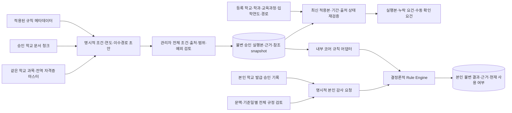

등록된 실행본 선택의 `catalog_complete`는 항상 false다. 학교가 확정한 기록 공급자와
전체 규정 완전성 확인 없이 공식 졸업요건 충족으로 표시하지 않는다.
[졸업요건 감사 API](api/graduation-audits.md)는 전체 목록·계층의 별도 검토와 본인 기록을
확인하고 불변 결과를 저장한다. 검토/감사 화면은 후속이다. [실행 규칙 API](api/rule-programs.md)와 구분한다.

### 학교 질의와 독립 AI 대화창

- Windows에서는 우측 AI 패널을 별도 Flutter OS 창으로 분리할 수 있다. Web은 도킹 패널과
  좁은 폭 오버레이를 사용한다.
- 도킹·분리 창은 같은 학교 질의 HTTP 어댑터와 응답 위젯을 사용한다. 질문과 사용자가 확인한
  학교 문맥만 전송한다. 학교 질의 API와 Flutter 연동 코드가 이 브랜치에 함께 포함된다.
- 대화·질문·요청은 메인이 소유하고 IPC로 창 사이에 공유한다. 학교 질의 문맥은 저장된 개인 프로필(실제 일반 계정은 서버 저장)을 공유하고 Windows 분리 창은 메인 창에 IPC로 조회·저장을 요청한다. 서버 대화
  저장·동기화는 conversation_id 등의 별도 계약이 필요한 후속 구현이다.
- 메인 창의 채팅 아이콘은 기존 독립 창이 있으면 새 창을 만들지 않고 해당 창을
  전면화한다. Windows 목업에서 메인 창을 닫으면 분리 AI 창을 먼저 명시적으로
  종료한 뒤 전체 앱을 종료한다.
- Windows 분리 창은 `frontend/third_party/desktop_multi_window`의 로컬 패치본을
  사용한다. 닫힌 보조 창의 Flutter 엔진은 다음 창 생성까지 보류하지 않고, 메인
  이벤트 루프에서 즉시 해제해 앱 종료 지연을 방지한다.

## 전체 기술 관계도

현재 인증 흐름:

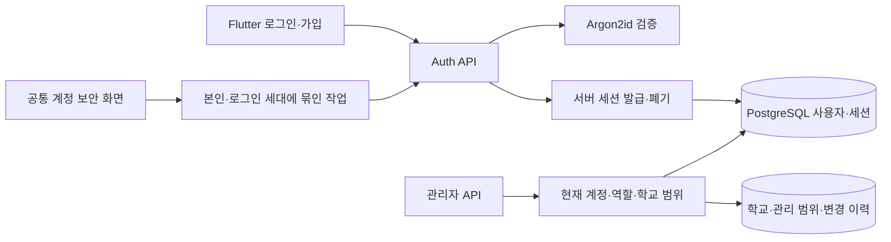

아래 전체 도메인/외부 서비스 관계는 목표 구조다. 인증·운영자 초기화는
[인증 API](api/authentication.md)를 따른다. 이메일/학교 담당자 신원 확인은 후속이다.
[개인 자료 API](api/personal.md)와 [학생용 학사 조회](api/student-catalog.md)는 구현했고,
프론트의 실제 일반 계정 프로필·일정·개인 기록·구성·지원 문서는 서버 저장이며 기기 원본/debug는 사용자 UUID별 로컬 저장이다. 공통 AuthApi의 사용자 UUID·로그인 세대에 묶인 전송 adapter와 Pydantic DTO를 사용한다. 서버는 선택 X-Unipath-Owner 헤더를 실제 신원과 비교해 탭 간 계정 전환 중 저장을 차단한다. 프로필·일정의 동의 이전은 기기 journal로 같은 요청을 재개하며 원본을 보존한다. 다른 개인 자료 10종은 전체 참조/순서를 변환해 별도 동의 이전을 제공한다. 실제 관리자 전송도 같은 소유자 조건을 사용한다.
[개인 계산 API](api/personal-evaluations.md)는 별도 typed 전송 adapter를 제공하며
실제 일반 계정의 개인 계산 화면은 다섯 명시 조건·선택 자료 버전·계산/불변 이력 조회/삭제를 연결했다. 전송한 요청은 작업 공간에서 고정해 같은 client UUID로 재시도한다. RAG/LLM은 이 계산에 참여하지 않는다.

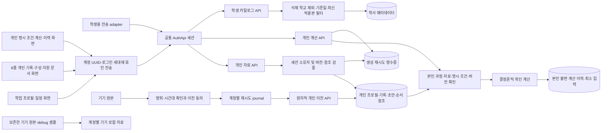

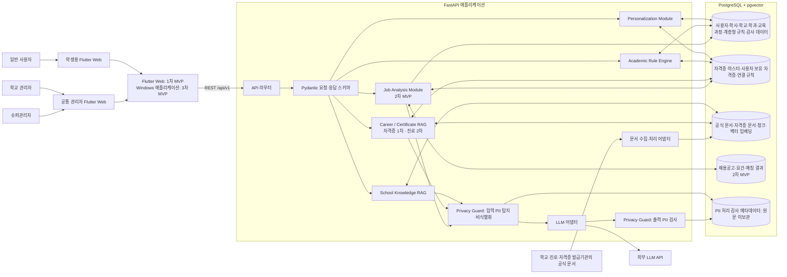

## 모듈 분류도

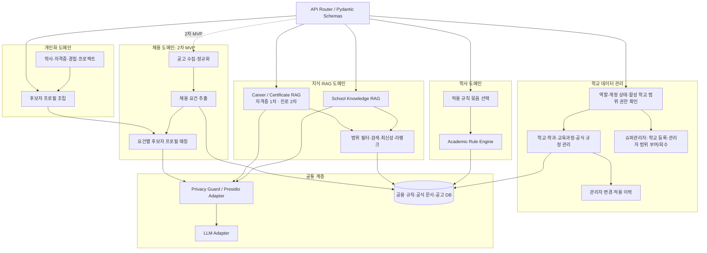

| 모듈 | 책임 | 개인 데이터 처리 |
|---|---|---|
| Academic Rule Engine | 학교·학과·교육과정 규칙의 결정론적 졸업 판정 | 이수·자격증·봉사 승인시간 등 필요한 값만 입력으로 사용 |
| School Knowledge RAG | 학교 규정의 근거 검색·출처 제공 | 학교·학과·교육과정 범위만 사용 |
| Career / Certificate RAG (자격증 1차, 진로 2차) | 자격증·진로 공식 정보 검색·출처 제공 | 자격증·진로 분류만 사용 |
| Personalization Module | 학사·자격증·경험·프로젝트를 후보자 프로필로 조립 | 사용자 로컬 원본 데이터의 처리 경계 |
| Job Analysis Module (2차 MVP) | 공고 요건 추출과 후보자 프로필 매칭 | 공고 요건과 최소화된 후보자 프로필 비교 |
| Privacy Guard / LLM Adapter | LLM 전송 전후 PII 보호와 공급자 분리 | 원문을 최소화·비식별화해 외부 전송 |

학교 데이터가 없는 일반 사용자는 공용 모듈과 개인 직접 입력을 계속 사용할 수 있다.
이 경우 `Academic Rule Engine`과 `School Knowledge RAG`는 공식 학교·학과·교육과정
범위가 확인되지 않았으므로 **공식** 졸업 판정이나 학교 규정 답변을 추정하지 않는다.
제품이 개인 학교·학과 기준 기능을 도입하면, 학생이 구성한 개인 규칙과 직접 입력 기록은
별도 개인 기준 계산에만 사용한다. 이 계산은 `개인 기준 계산 · 학교 공식 판정 아님`으로
표시하며, 공식 규칙 묶음·다른 사용자·학교 RAG 근거를 변경하지 않는다. 학교 관리자가
공식 데이터를 등록하고 적용 범위가 사용자 프로필과 일치하면 이후 요청부터 공식 데이터가
개인 규칙보다 우선한다. 개인 이수·활동·자격증 데이터는 대체하거나 삭제하지 않는다.

## 핵심 책임과 요청 흐름

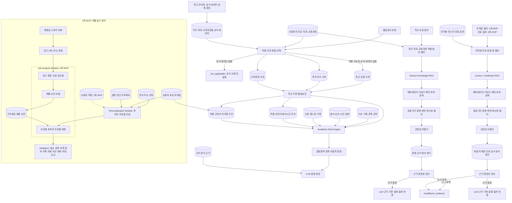

- 졸업요건의 충족·미충족 판정은 반드시 `Academic Rule Engine`이 수행한다.
  LLM은 판정 결과를 변경하지 않고, 판정과 공식 문서 근거를 자연어로 설명한다.
- 졸업감사 시작 시 사용자의 학교·학과·적용 교육과정을 기준으로 학교 공통,
  학과 추가, 교육과정별 규칙 묶음을 모두 선택한다. Rule Engine은 과목 이수·최소
  성적·자격증·봉사 승인시간·논문 등 각 규칙을 개별 판정하고, 통합 감사 결과와 규칙별 결과를
  함께 저장한다.
- 적용 가능한 공식 규칙 묶음이 없으면 Rule Engine은 졸업 가능 여부를 추정하지 않고
  `not_applicable`을 반환한다. 사용자가 입력한 개인 임시 요건은 개인 참고 분석에만
  사용할 수 있으며, 공식 감사 결과나 공식 규정으로 표시하지 않는다.
- RAG는 문서 청크와 출처 메타데이터를 검색한다. 근거가 부족하면 추측하는 대신
  `insufficient_evidence` 상태를 반환한다.
- AI 응답은 가능한 경우 문서 제목, URL, 페이지, 문서 식별자를 함께 반환한다.

### RAG별 책임

- `School Knowledge RAG`는 질의자의 학교·학과·적용 교육과정을 필터로 사용해
  해당 범위의 공식 학사 문서와 청크만 검색한다. 졸업 가능 여부 자체를 판정하지
  않으며, 규정의 근거와 설명을 제공한다.
- `Career / Certificate RAG`의 자격증 안내·응시 요건·발급 기준 검색은 1차 MVP에
  포함한다. 진로 분류와 진로 정보 검색은 2차 MVP에 포함한다. 두 기능 모두 사용자
  보유 자격증의 유효 여부나 졸업요건 충족 여부는 판정하지 않는다.
- 두 RAG 모두 검색된 문서 청크의 제목, URL, 페이지, 문서 식별자를 출처로
  반환한다. 필터 이후 충분한 근거가 없으면 LLM 호출로 내용을 보완하지 않고
  `insufficient_evidence`를 반환한다.

### 최신성 및 리랭크

- 최초 검색은 학교·학과·교육과정 또는 자격증·진로 범위의 메타데이터 필터를 먼저
  적용하고, 키워드 검색과 pgvector 유사도 검색으로 후보 문서 청크를 만든다.
- 최신성 단계는 발행일만으로 순서를 정하지 않는다. 문서의 적용 기간, 원문 갱신일,
  수집 확인일, 버전과 공식 출처 여부를 확인해 만료·대체된 문서를 제외하거나 낮은
  우선순위로 둔다.
- 리랭커는 최신성 필터를 통과한 후보 청크를 질문과의 관련성 기준으로 재정렬한다.
  리랭킹은 답변이나 졸업요건 판정을 수행하지 않으며, 최종 근거 선정만 돕는다.
- RAG 캐시 키에는 질의·적용 범위뿐 아니라 문서 버전 또는 코퍼스 버전을 포함한다.
  문서가 갱신되면 이전 검색·답변 캐시는 재사용하지 않는다.

### 채용 매칭 책임 (2차 MVP)

- `Job Analysis Module`은 공고 URL 또는 원문에서 채용 요건을 구조화한다. 공고의
  자격증·역량·학력·경력·우대 조건은 `JobRequirement` 및 관련 연결 데이터로
  보존한다.
- `Personalization Module`은 학사 이수·성적, 보유 자격증, 경험·개인 프로젝트,
  이후 도입되는 사용자 역량을 합쳐 요청 시점의 후보자 프로필을 만든다.
- 매칭기는 구조화된 공고 요건과 후보자 프로필을 항목별로 비교해 `JobMatch`와
  `JobMatchDetail`을 생성한다. 필수 요건은 충족·부족·정보 부족으로, 우대 요건은
  점수·부족 항목·자동 비교 제외 항목으로 분리한다. 자동 비교하지 못했거나 하지
  않도록 정한 모든 우대조건은 이유와 출처를 포함해 하나의 추가 안내 목록으로
  반환한다. 따라서 결과는 채용 합격 예측이 아니라 설명 가능한 공고 요건 적합도이며,
  LLM이 단독으로 결정하지 않는다.
- 후보자 프로필·매칭 결과의 재사용은 원본 개인정보의 영구 보관을 뜻하지 않는다.
  공고 분석처럼 공용으로 재사용할 수 있는 데이터는 저장하되, 개인화된 매칭 결과는
  최소한의 판정 근거만 저장하고 사용자 삭제·보유기간 만료 시 관련 캐시와 함께 파기한다.

## 자격증 정보 처리 경계

- `Certificate`, `UserCertificate` 및 학사·채용 연결 규칙은 PostgreSQL의 구조화된
  데이터로 관리한다. 사용자의 자격증 등록과 유효기간·등급·상태 확인은
  `Personalization Module`이 담당한다.
- `Career / Certificate RAG`는 자격증 시험 안내, 응시 자격, 발급 기준 등 공식
  문서를 검색하고 출처를 제공한다. RAG 결과가 사용자의 자격증 보유 여부를
  확정하지는 않는다.
- `Academic Rule Engine`은 먼저 학교·학과·교육과정의 적용 졸업 규칙을 선택한다.
  그중 자격증 조건이 있는 규칙만 `GraduationRuleCertificate`를 통해
  `UserCertificate`와 비교하고, 자격증 상태·등급·유효기간을 반영해 해당 규칙의
  충족 여부를 판정한다. 2차 MVP의 `Job Analysis Module`은 같은 데이터를
  채용공고의 자격증 요건과 비교해 매칭 근거를 생성한다.

## 운영 환경 경계

앱 통합·빌드·릴리스·서버 배포는 이어진이 담당한다. `compose.server.yaml`은
환경별 정적 Web 서비스와 공통 HTTPS 게이트웨이 연결을 추가한다.
`staging-unipath.duckdns.org`는 `unipath-staging` 프로젝트에, `unipath.duckdns.org`는
`unipath-product` 프로젝트에 연결한다. 각 프로젝트의 API·DB 네트워크, DB 볼륨과
비밀번호는 분리하고 동일한 FastAPI 이미지를 사용한다. 공개 게이트웨이에는 Web만
연결하며 Web이 인증·관리자·학교 질의·readiness API를 내부 FastAPI로 프록시한다.
다운로드 앱의 API도 해당 HTTPS 원점을 사용한다. develop은 실제 계정/역할·학업 프로필/일정·개인 기록·구성·지원 문서의 서버 저장과 기기 원본 보존을 제공한다. main은 명시적 승격 전 이전 프리뷰를 유지한다. 운영 학사/공식 판정·LLM 완성과 구분한다.
구체적인 설정·HTTPS 개통·GitHub 다운로드 절차는 [`releases.md`](releases.md)를 따른다.

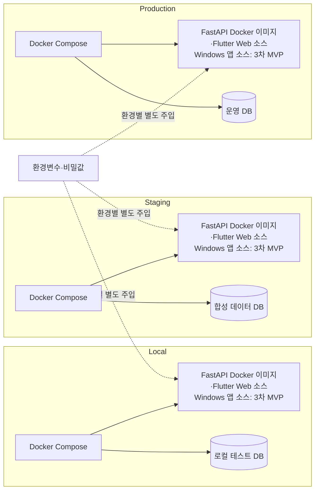

- Local, Staging, Production은 FastAPI Docker 이미지와 Flutter Web 소스 코드를
  공유하지만, 데이터베이스와 비밀값은 서로 분리한다. Windows 애플리케이션은 3차
  MVP에서 같은 API 계약을 사용하는 별도 클라이언트로 추가한다. Staging과
  Production은 같은 DB를 사용하지 않는다.
- API 키, 비밀번호, 토큰 및 실제 `.env` 파일은 저장소에 포함하지 않는다.
- 외부 LLM과 문서 수집원 의존성은 어댑터 또는 설정 계층 뒤에 두어 핵심 도메인
  로직이 특정 공급자에 직접 결합하지 않게 한다.

## 개인정보 보호 어댑터

- `Privacy Guard`는 외부 LLM으로 전달되는 자유 텍스트, 개인화 RAG 캐시, 로그의
  입력·출력 경계에 둔다. 탐지 결과에 따라 마스킹·대체·차단을 수행하고, 원문 대신
  최소한의 비식별화 텍스트만 다음 단계에 전달한다.
- Presidio는 이 어댑터의 후보 구현체다. Analyzer는 인식기 기반 PII 탐지를 지원하고,
  Anonymizer는 탐지된 값의 마스킹·대체·암호화 처리를 지원한다. 한국어·학교별
  식별자 정확도는 별도 커스텀 인식기와 테스트로 검증한 뒤 사용한다.
- 감사 로그는 정책 버전, 처리 동작, 탐지 유형 수 등 최소 메타데이터만 저장한다.
  이름, 학번, 자격증 번호, 원문 질의·응답은 감사 로그에 저장하지 않는다.
