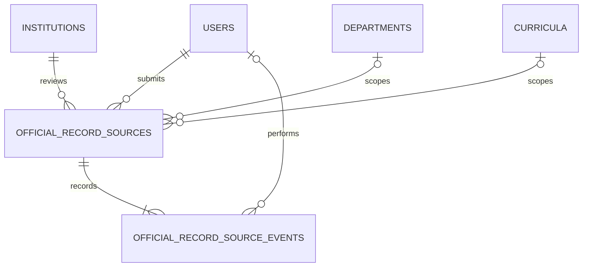
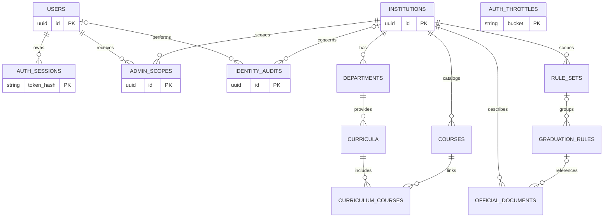
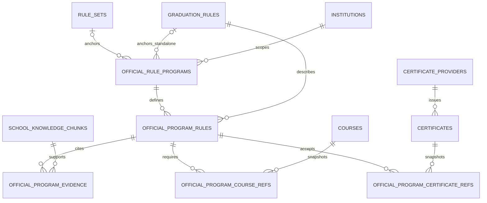
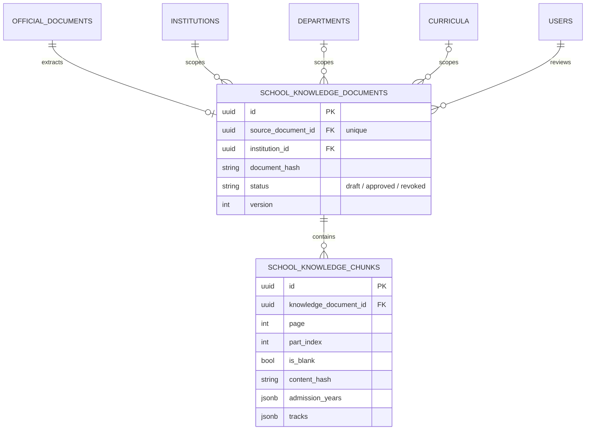
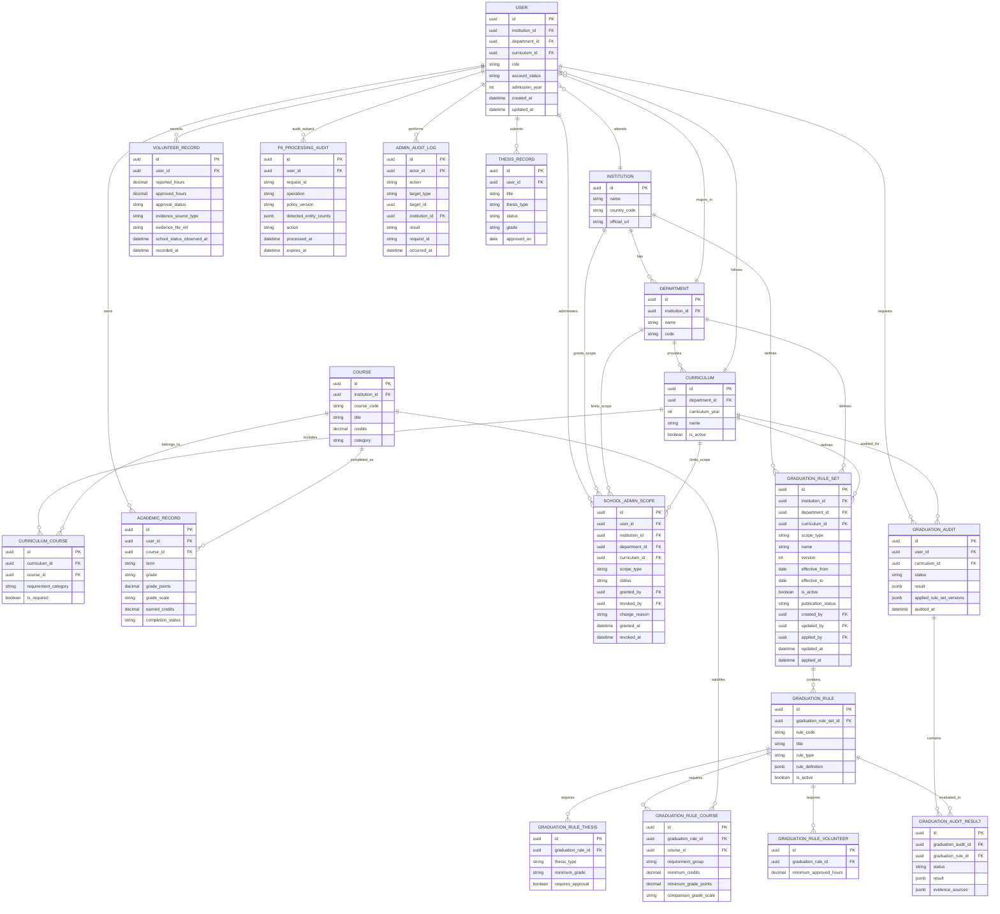
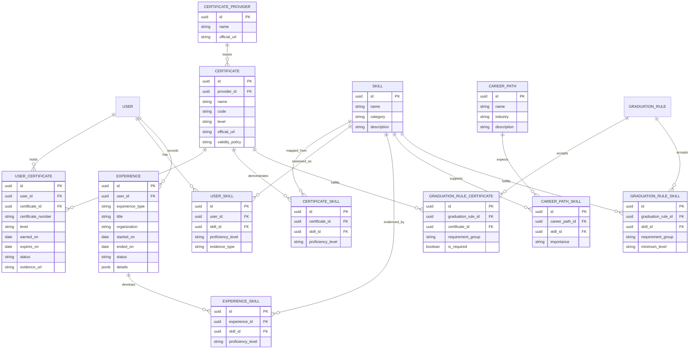
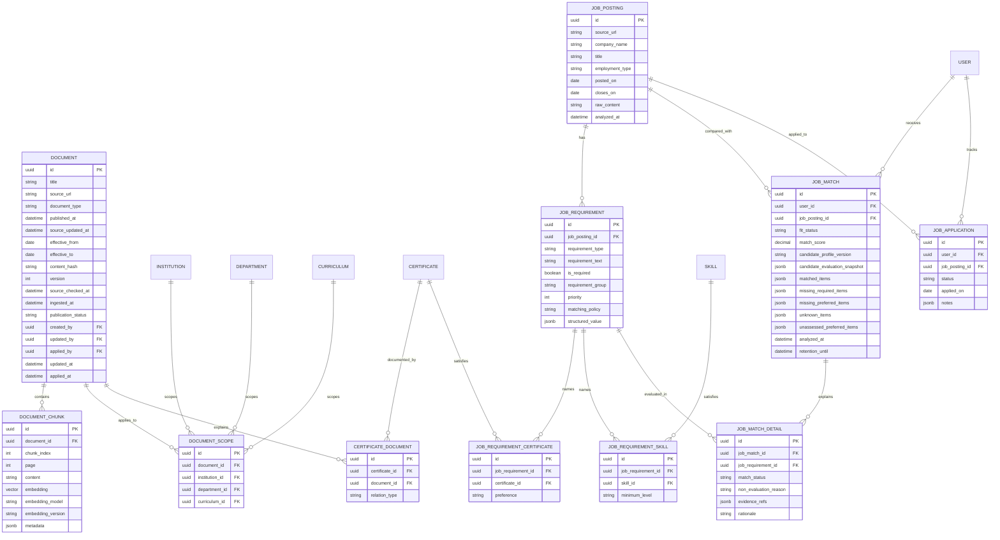

# 확장 데이터베이스 ERD 및 MVP 단계

이 문서는 UniversityPath AI의 **전체 논리 데이터 모델**과 단계별 실제 도입
범위를 정의한다. README에 제시된 대표 핵심 엔터티를 바탕으로, 아래 모델은
자격증·역량·진로·채용·개인화를 확장하기 위한 기준이다.

모든 식별자는 UUID를 사용한다. 실제 DB 모델과 외부 API 스키마는 분리하며,
각 단계에서 필요한 테이블만 Alembic 마이그레이션으로 생성한다.

`0001_enable_pgvector`는 vector 확장을 활성화하고 `0002_identity_sessions`는 실제
users·auth_sessions·auth_throttles·institutions·admin_scopes·identity_audits 6개 테이블을
생성한다. `0003_academic_catalog`는 departments·curricula·courses·curriculum_courses·
rule_sets·graduation_rules·official_documents를 추가했다. `0004_personal_records`는
개인 프로필·개인 자료 11종·순서 참조 2종·재시도 영수증 15개를 추가했다.
`0005_personal_evaluations`는 개인 계산 이력 하나를 추가한다. `0006_school_knowledge`는
학교 문서 추출/검토와 청크 2개를 추가한다. `0007_official_rule_programs`는 자격증/발급기관
마스터와 실행 규칙·근거·마스터 참조 7개를 추가한다. `0008_personal_imports`는 개인 자료
일괄 이전의 최소 영수증 하나를 추가한다. `0009_official_record_sources`는 학교 발급 자료의
비공개 원본과 검토 이벤트 2개를 추가해 **총 41개 테이블**을 물리 구현한다.
학교 메타데이터/버전/삭제 표시와 범위 회수 사유도 추가한다.
아래 전체 논리 ERD/단계 표 중 학생 공식 기록·공식 판정·벡터 임베딩은 도입 계획이다.
현재 users에는 학교/학과/교육과정 FK가 없으며 자유 입력 프로필을 공식 학적으로 승격하지 않는다.
임베딩 모델/차원은 미정이며 pgvector 검사는 합성 임시 테이블을 사용한다.

학교 발급 자료는 [원본 제출·검토 계약](api/official-record-sources.md)으로 본인이 검토를
허용한 학교 범위에만 공유한다. `official_record_sources`는 소유자·학교/학과/교육과정 복합
FK, 본인/client_id UNIQUE, 파일 SHA-256·크기 CHECK와 BYTEA 원본을 보관한다.
`official_record_source_events`는 원본 FK와 원본/버전 UNIQUE로 수행자·상태 전이·비공개
사유를 보관한다. 원본은 불변이며 이벤트는 추가만 한다. 철회는 관리자 열람을 종료하며
파일을 자동 삭제하지 않는다. 이 두 테이블은 정규화된 학생 공식 성적/봉사/자격 테이블이나
공식 졸업감사를 대신하지 않는다.

개인 자료의 물리 관계는 아래와 같다. 모든 개인 항목은 owner_id로 제한하며 자원 간 참조는
(id, owner_id) 복합 FK를 사용한다. 개인 과목·규칙의 교육과정도 같은 소유자/과정으로 검사한다.
생성 영수증은 삭제된 자료를 재시도로 되살리지 않도록 원문 없이 식별자·지문만 보존한다.
공식 학적·성적 테이블과 구별하며 [개인 자료 계약](api/personal.md)을 따른다.

```mermaid
erDiagram
    USERS ||--o| PLANNING_PROFILES : plans
    USERS ||--o{ PERSONAL_EVENTS : schedules
    USERS ||--o{ PERSONAL_COURSE_RECORDS : owns
    USERS ||--o{ PERSONAL_ACTIVITY_RECORDS : owns
    USERS ||--o{ PERSONAL_EXPERIENCE_RECORDS : owns
    USERS ||--o{ PERSONAL_CREDENTIAL_RECORDS : owns
    USERS ||--o{ PERSONAL_ACHIEVEMENT_RECORDS : owns
    USERS ||--o{ PERSONAL_CURRICULA : owns
    USERS ||--o{ PERSONAL_CURRICULUM_COURSES : owns
    USERS ||--o{ PERSONAL_GRADUATION_RULES : owns
    USERS ||--o{ PORTFOLIO_COMPOSITIONS : owns
    USERS ||--o{ APPLICATION_DOCUMENTS : owns
    USERS ||--o{ PERSONAL_CREATION_RECEIPTS : retries
    USERS ||--o{ PERSONAL_IMPORT_RECEIPTS : imports
    USERS ||--o{ PERSONAL_EVALUATIONS : retains
    PERSONAL_EVALUATIONS {
        uuid id PK
        uuid owner_id FK
        uuid curriculum_id "historical identity, no live FK"
        int curriculum_version
        date evaluated_on
        jsonb result_json
        jsonb input_snapshot_json
    }
    PERSONAL_IMPORT_RECEIPTS {
        uuid owner_id PK,FK
        uuid import_id PK
        string digest
        int record_count
        int profile_version "historical version"
        jsonb mappings_json "historical UUIDs and versions, no live FK"
        datetime committed_at
    }
    PERSONAL_CURRICULA ||--o{ PERSONAL_CURRICULUM_COURSES : includes
    PERSONAL_CURRICULA ||--o{ PERSONAL_GRADUATION_RULES : defines
    PERSONAL_COURSE_RECORDS o|--o{ PERSONAL_CURRICULUM_COURSES : links
    PERSONAL_CURRICULUM_COURSES o|--o{ PERSONAL_GRADUATION_RULES : references
    PERSONAL_COURSE_RECORDS o|--o{ PERSONAL_GRADUATION_RULES : relates
    PERSONAL_ACTIVITY_RECORDS o|--o{ PERSONAL_GRADUATION_RULES : relates
    PERSONAL_EXPERIENCE_RECORDS o|--o{ PERSONAL_GRADUATION_RULES : relates
    PERSONAL_CREDENTIAL_RECORDS o|--o{ PERSONAL_GRADUATION_RULES : relates
    PERSONAL_ACHIEVEMENT_RECORDS o|--o{ PERSONAL_GRADUATION_RULES : relates
    PORTFOLIO_COMPOSITIONS ||--o{ PORTFOLIO_SOURCES : orders
    PERSONAL_ACHIEVEMENT_RECORDS ||--o{ PORTFOLIO_SOURCES : sources
    APPLICATION_DOCUMENTS ||--o{ APPLICATION_DOCUMENT_SOURCES : orders
    PERSONAL_ACHIEVEMENT_RECORDS o|--o{ APPLICATION_DOCUMENT_SOURCES : sources
    PERSONAL_EXPERIENCE_RECORDS o|--o{ APPLICATION_DOCUMENT_SOURCES : sources
    INSTITUTIONS o|--o{ PLANNING_PROFILES : selected
    DEPARTMENTS o|--o{ PLANNING_PROFILES : selected
    CURRICULA o|--o{ PLANNING_PROFILES : selected
```

인증 필드·운영자 생성·원자성과 후속 경계는 [인증 API](api/authentication.md)를 따른다.
개인 일괄 이전은 자료·관계·생성 영수증과 최소 이전 영수증을 한 트랜잭션에 저장한다.
대응표의 자료 ID/버전은 이력이며 삭제 후에도 재생성하지 않도록 live FK로 연결하지 않는다.
원문을 영수증에 중복 저장하지 않는다. [이전 API](api/personal-imports.md)를 따른다.
범위는 학교 전체만 지원하며 하위 학과/교육과정 범위는 미구현이다. 모델과 물리 스키마를
`alembic check`로 대조한다.

기존 학교 질의 API는 로컬 JSONL 청크와 메모리 BM25 인덱스를 사용한다.
새 UUID 문맥 검색은 `school_knowledge_documents`·`school_knowledge_chunks`에 관리자 범위로
추출본·검토/회수 이력·최소 본문/범위를 저장하고 승인본의 BM25 인덱스를 재사용한다.
pgvector 임베딩은 미연결이며 질문·답변·대화 이력도 DB에 저장하지 않는다.
파일 플래그와 공식 문서 메타데이터 적용은 이 별도 RAG 승인 절차를 대신하지 않는다. 학사 관리의
버전·소속 복합 FK·삭제 보관 정책은 [학사 API](api/academic.md)를 따른다.

공식 실행 규칙의 물리 관계는 다음과 같다. 실행본은 적용된 집합 또는 독립 요건 하나를
참조한다. 하위 실행 조건·근거·과목 참조는 학교 복합 FK로 다른 학교 자료 연결을 차단한다.
`school_knowledge_chunks(id, institution_id)` 고유 키도 새 마이그레이션에서 추가한다.
초안 삭제 시 하위 조건/근거/참조만 cascade하며 원본·과목·문서·자격증은 삭제하지 않는다.
승인본·회수본은 이력으로 보존한다. 세부 계약은 [실행 규칙](api/rule-programs.md)과
[자격증 마스터](api/certificates.md)를 따른다.

`app/rules/`에는 학점·필수과목·봉사·자격증·논문 요건의 독립 계산 코어를 구현했다.
공식 규칙의 계층·입학연도·이수경로·유효기간·버전 선택과 개인 기준 계산을 구분하며
내부의 `RuleSet`·`Snapshot`·`Evaluation` 계약을 사용한다. 이 계약은 SQLAlchemy 모델이나
공개 API 스키마가 아니며 아래 논리 엔터티를 생성하지 않는다. 승인 실행본을 코어로 전달하는
내부 어댑터를 제공한다. 학교 확정 기록·소유권·학교별 성적/재수강 정책을 확인하는
공식 기록 DB 어댑터와 공식 감사 저장은 후속 단계다.
개인 DB 어댑터는 별도 DTO로 본인 자료·명시적 조건을 검증하고
`personal_evaluations`에 불변 결과·조건·최소 계산 입력·버전을 보관한다.
과정/자료 ID는 삭제 후에도 과거 결과가 유지되는 역사적 참조이며 live FK가 아니다.
소유자 FK·개인 표시/상태 CHECK·소유자/재시도 키 UNIQUE와 목록 인덱스를 적용한다.
소유자는 결과/snapshot을 삭제할 수 있고 생성 영수증은 삭제 결과의 재생성을 막는다.
[개인 계산 계약](api/personal-evaluations.md)을 따르며 아래 공식 GraduationAudit와 구별한다.
계산 경로·누락 정보 처리·범위/버전 충돌은 [Rule Engine 문서](rule-engine.md)를 따른다.
현재 DB의 백업·격리 복구 검증은 [백업 문서](database-backups.md)를 따른다.

학교 지식의 물리 관계는 다음과 같다. 학사 문서 UUID별 추출본은 하나이며 새 원본은 학사 문서의
새 적용 판본을 사용한다. 소속은 원본에서 결정하고 학교 복합 FK로 보호한다. 승인/회수본은
불변이며 초안 삭제만 청크를 함께 지운다. chunk 행의 is_blank는 검토자가 확인한 빈 페이지이고
검색 본문·인용에는 포함하지 않는다. 원본 hash는 검토자 제공 값이며 파일 자동 검증을 뜻하지 않는다.

업로드·검토·기간/판본/캐시 경계는 [학교 지식 API](api/school-knowledge.md)를 따른다.
아래 논리 Document/DocumentChunk/DocumentScope는 임베딩·다른 지식 종류까지 포함한 목표 모델이다.

## 1. 학사 및 사용자 코어

`User.role`은 `user`, `school_admin`, `super_admin` enum으로 설계한다. `school_admin`은
`SchoolAdminScope`에서 부여된 학교·학과·교육과정 범위의 공식 데이터만 관리할 수
있다. 사용자의 학교·학과·교육과정 FK는 데이터 미등록 또는 미지원 학교 사용자를
지원하기 위해 nullable로 설계할 수 있으며, 직접 입력한 학사·활동 데이터의 소유권은
학교 데이터와 독립적으로 항상 사용자에게 남는다. 실제 학교 관리자 신원 검증 및
권한 부여 절차는 구현 전에 별도로 확정한다.

### 관리자 역할·범위 보완안

아래 항목과 ERD 추가 필드는 논리 설계 제안이다. 확정된 OpenAPI 계약이나 실제 DB 구현이 아니다.
한 계정은 역할 하나를 갖고 별도 Role/Permission 테이블은 이번 단계에서 추가하지 않는다.
`account_status`는 `active`, `suspended`이며 정지 계정은 관리자 작업을 수행하지 못한다.

| 역할 | 관리 권한 |
|---|---|
| user | 본인 개인 기록 |
| school_admin | 활성 SchoolAdminScope 범위의 학과·교육과정·과목·규칙·문서 |
| super_admin | 학교 등록·수정, 기존 사용자 관리자 범위 부여·회수, 전체 학교 공식 데이터 |

두 관리자 역할에는 학생 개인 기록 조회·수정 권한을 자동 부여하지 않는다.
학교 관리자는 자신의 범위에서 규칙·문서를 직접 검토·확인 후 적용하며 슈퍼관리자 승인을 요구하지 않는다.

SchoolAdminScope는 학교 관리자에게만 부여한다. `scope_type`은 `institution`, `department`,
`curriculum`이다. 학교는 필수이며 학교 전체 범위는 하위 FK가 null, 학과 범위는 학과만 필수,
교육과정 범위는 학과·교육과정 모두 필수다. 학과의 학교 및 교육과정의 학과 일치를 검증한다.
`status`는 `active`, `revoked`이며 동일 사용자·동일 범위의 활성 중복을 막는다.
부여·회수 주체와 시각 및 변경 사유를 기록한다. 회수된 범위는 이력으로 보존한다.

AdminAuditLog는 관리자 변경의 수행자·행동·대상·학교·결과·시각·요청 식별자를 기록한다.
개인정보 비식별화 메타데이터용 PiiProcessingAudit와 별개이며, 비밀번호·토큰·학생 기록 원문은 저장하지 않는다.
규칙 묶음·공식 문서는 `draft`, `applied`로 구분하고 생성·수정·적용 주체와 시각을 기록한다.
적용 버전은 수정하지 않고 새 버전 초안을 만들어 기존 적용 이력을 보존한다.
규칙 묶음과 연결된 규칙은 버전 단위로 함께 보존해야 한다.

계정 발급·인증/세션·최초 슈퍼관리자 CLI와 학교 전체 관리 범위의 물리 제약은
위 인증 테이블 및 [인증 API](api/authentication.md)에 구현됐다. 학교 담당자의 실제
신원 확인 절차, 학과/교육과정 범위의 물리 제약과 이력 보유기간은 후속 계약 항목이다.

`GraduationRuleSet`은 규칙의 적용 계층을 표현한다. 한 사용자의 졸업감사에는
해당 학교의 `institution` 규칙 묶음, 소속 학과의 `department` 규칙 묶음, 적용
교육과정의 `curriculum` 규칙 묶음을 함께 선택해 모두 판정한다. 즉 학교 공통
규정만 충족해도 학과 추가 요건을 통과하지 못하면 최종 결과는 충족이 아니다.

규칙 묶음의 `scope_type`은 `institution`, `department`, `curriculum` enum으로
제한한다. 구현 시에는 범위에 맞는 FK만 지정되도록 제약한다. 즉 학교 규칙은
`institution_id`만, 학과 규칙은 `institution_id`와 `department_id`, 교육과정
규칙은 세 범위 FK를 모두 가진다. 감사에는 사용된 규칙 묶음의 버전을 스냅샷으로
남기며, 이미 실행된 감사에 적용된 규칙 묶음을 변경·재작성하지 않는다.

사용자가 직접 구성한 학교·학과·교육과정 규칙은 공식 `GraduationRuleSet`과 분리된
개인 규칙 세트로 관리한다. 이 세트는 지원하지 않는 학교의 학생이 자신의 직접 입력
기록을 기준으로 개인 기준 계산을 수행할 때만 사용하며, 공식 규칙·공식 문서·다른
사용자에게 반영하지 않는다. 개인 계산 결과는 공식 `GraduationAudit`와 다른 유형 또는
명시적인 `official=false` 구분을 가져야 한다. 학교 관리자가 공식 규정과 적용 범위를
등록하면 공식 `GraduationRuleSet`이 공식 감사에서 우선하며, 개인 규칙이나 사용자의
이수기록을 덮어쓰거나 삭제하지 않는다. 적용 가능한 공식 규칙 묶음이 하나도 없으면
공식 `GraduationAudit.status`는 `not_applicable`으로 기록하고 졸업 가능 여부를
판정하지 않는다.

과목 최소 성적 요건은 원 성적 표기(`grade`)와 계산용 점수(`grade_points`)를
함께 보존하고, `GraduationRuleCourse`의 기준 점수와 `comparison_grade_scale`로
비교한다. 학교별 성적 체계 차이는 Rule Engine의 성적 환산 정책에서 처리한다.

`GraduationRule`은 반드시 Rule Engine이 해석한다. `rule_definition`은 복잡한
계산식을 보조하지만, 과목·자격증·논문·역량처럼 교차 도메인에서 직접 참조하고
검증할 요소는 관계 테이블로도 모델링한다. `GraduationAudit`은 한 번의 통합 감사
실행을, `GraduationAuditResult`는 각 규칙의 세부 판정과 출처를 보존한다.

`VolunteerRecord`는 사용자가 직접 입력하거나 학사정보시스템 화면 캡처를 근거로
등록한 **개인 학사정보**다. `reported_hours`는 사용자가 입력한 시간,
`approved_hours`는 사용자가 학교 시스템에서 승인됨을 확인한 시간이다.
`approval_status`는 `pending`, `approved`, `rejected`, `needs_review` enum으로
관리한다. `evidence_source_type`은 `manual_input`, `screenshot`, `other` enum이며,
`evidence_file_ref`에는 영구 저장소 어댑터가 반환한 참조값만 보관한다. 증빙 파일
원문·OCR 텍스트는 공용 RAG, 로그, 외부 LLM으로 전달하지 않는다.

`GraduationRuleVolunteer.minimum_approved_hours`는 학교·학과·교육과정의 공식 규정에서
등록한다. Rule Engine은 `approval_status=approved`인 `VolunteerRecord.approved_hours`의
합계와 이 값을 비교한다. 승인 시간이 없거나 상태가 불명확하면 미충족으로 단정하지
않고 `needs_review`를 반환한다.

## 2. 자격증·역량·진로 확장

자격증은 `Certificate`를 공통 기준 엔터티로 사용한다. 따라서 사용자 보유 현황,
졸업요건 충족 여부, 채용공고 요건, 공식 RAG 문서를 각각 독립적으로 연결하면서도
동일한 자격증을 참조한다. `requirement_group`은 “A·B·C 중 하나” 같은 대체
요건을 표현하기 위한 그룹 식별자다.

졸업감사에서는 먼저 사용자에게 적용되는 학교·학과·교육과정의 규칙 묶음을
선택한다. 그 규칙 묶음 안의 `GraduationRuleCertificate`만 `UserCertificate`와
`Certificate`를 기준으로 비교한다. 즉 보유 자격증이 독립적으로 졸업을 판정하는
것이 아니라, 학교가 정의한 자격증 조건의 충족 여부를 증명한다.

## 3. RAG 지식 및 채용 분석 확장

채용공고는 기본적으로 URL 또는 원문을 `JobPosting`에 수집한 뒤, 구조화된
`JobRequirement`로 추출·매칭한다. 공고 자체를 RAG 코퍼스로 삼을 필요는 없다.
향후 다수 공고의 의미 기반 탐색이 필요해질 때에만 별도 공고 청크·임베딩을
추가한다.

`JobMatch`는 공고 요건과 요청 시점의 후보자 프로필을 비교한 결과다. 후보자
프로필은 `AcademicRecord`, `UserCertificate`, `Experience`(개인 프로젝트 포함),
2차 MVP의 `UserSkill`을 조합해 서비스 계층에서 생성한다.
`candidate_profile_version`과 `candidate_evaluation_snapshot`에는 전체 프로필 원문이
아니라 매칭 당시의 프로필 버전, 요건별 판정값, 필요한 근거 레코드 식별자만
최소한으로 보존한다. 이후 이력 변경에도 결과의 근거를 재현할 수 있지만, 자격증
번호·프로젝트 원문 등 불필요한 개인정보를 중복 저장하지 않는다.
`retention_until` 이후에는 결과와 스냅샷을 자동 파기한다.

`JobRequirement.is_required`는 필수와 우대 요건을 구분한다. `requirement_group`은
“학위 또는 특정 자격증”처럼 대체 가능한 요건을 하나의 조건으로 묶고, `priority`는
우대 요건의 점수 반영 순서를 나타낸다. `matching_policy`는 `evaluated`,
`manual_review`, `informational_only` enum으로 정의하며, 공고 조건마다 자동 비교,
사용자 확인, 정보 제공 전용 여부를 결정한다. `JobMatch.fit_status`는 다음 enum으로
정의한다.

- `meets_required_requirements`: 모든 필수 요건이 충족됨
- `missing_required_requirements`: 하나 이상의 필수 요건이 부족함
- `insufficient_profile_data`: 필수 요건 판정에 필요한 사용자 정보가 부족함
- `needs_review`: 자동 비교할 수 없는 모호한 조건 또는 증빙 검토가 있음

`JobMatchDetail.match_status`는 각 요건의 `met`, `missing`, `unknown`,
`not_evaluated`, `not_applicable`을 보존한다. `evidence_refs`에는 해당 판정을
뒷받침한 이수기록, 자격증, 경험·프로젝트 등의 식별자를 저장한다.

우대 요건 중 `unknown` 또는 `not_evaluated`인 항목은 이유와 함께
`unassessed_preferred_items`로 반환한다. `non_evaluation_reason`은
`profile_data_missing`, `manual_confirmation_required`, `policy_excluded`,
`extraction_uncertain`처럼 자동 비교하지 않은 이유를 저장한다. 이 목록은 특정
민감 조건을 별도 강조하지 않고, 모든 자동 비교 제외 우대조건을 같은 방식으로
공개한다. 이 결과는 채용 합격을 보장하거나 예측하지 않으며, 공고에 적힌 요건과
현재 프로필의 적합도를 보여 주는 값이다.

`Document`와 `DocumentChunk`는 학사·자격증·진로의 **공식 근거 검색용**이다.
`DocumentScope`와 `CertificateDocument`를 통해 학교·학과·교육과정·자격증의
적용 범위를 보존하며, AI 응답에는 문서 제목, URL, 페이지 및 문서 식별자를
반환한다.

`Document`의 `source_updated_at`, `effective_from`, `effective_to`, `content_hash`,
`version`, `source_checked_at`은 최신성 판단과 재수집을 위한 메타데이터다. 질의
시점에는 단순 발행일이 아니라 적용 기간, 원문 갱신 여부, 공식 출처 여부를 함께
고려해 현재 유효한 문서를 우선한다. 원문 해시 또는 임베딩 모델 버전이 달라지면
관련 청크를 재생성·재색인한다.

## 단계별 도입 계획과 현재 구현

현재 물리 구현은 인증/학교 범위·학사 메타데이터·개인 자료/참조/생성 및 이전 영수증·개인 계산·학교 지식·실행 규칙/자격증 39개 테이블이다. 아래 표는 각 단계의 전체 목표이며
나머지 학사·문서·판정 엔터티가 이미 생성됐다는 뜻이 아니다.

| 단계 | 목표 | 실제 생성·구현 대상 |
|---|---|---|
| 1차 MVP | 역할·학교 관리 범위, 계층형 학사 판정, 공식 문서·개인화 RAG, 자격증·봉사·논문·캡스톤 요건 관리 | `User`, `SchoolAdminScope`, `AdminAuditLog`, `Institution`, `Department`, `Curriculum`, `Course`, `CurriculumCourse`, `AcademicRecord`, `VolunteerRecord`, `GraduationRuleSet`, `GraduationRule`, `GraduationRuleCourse`, `GraduationRuleCertificate`, `GraduationRuleVolunteer`, `GraduationRuleThesis`, `GraduationAudit`, `GraduationAuditResult`, `ThesisRecord`, `CertificateProvider`, `Certificate`, `UserCertificate`, `Document`, `DocumentChunk`, `DocumentScope`, `CertificateDocument`, `Experience` |
| 2차 MVP | 진로 정보 RAG, 채용공고 분석, 역량 요건 및 설명 가능한 매칭 | `JobPosting`, `JobRequirement`, `JobRequirementCertificate`, `JobMatch`, `JobMatchDetail`, `Skill`, `UserSkill`, `CertificateSkill`, `ExperienceSkill`, `CareerPath`, `CareerPathSkill`, `GraduationRuleSkill`, `JobRequirementSkill` 및 사용자 경험·자격증 기반 추천 API |
| 3차 MVP | 취업 준비 과정 관리와 고도화된 추천 | `JobApplication`, 지원 상태·피드백 기반 추천, 필요 시 공고 의미 검색용 별도 청크·임베딩, 추천 이력·사용자 피드백 모델 |

## 공통 구현 규칙

- `status`, `completion_status`, `experience_type`, `rule_type`,
  `document_type`, `requirement_type`, `match_status`는 자유 문자열이 아닌 enum으로
  정의한다. 졸업 감사 상태는 `satisfied`, `not_satisfied`, `needs_review`,
  `not_applicable`을 사용한다.
- 졸업요건의 충족·미충족은 RAG나 LLM이 아니라 결정론적인 Rule Engine이
  `AcademicRecord`, `UserCertificate`, 관련 규칙을 이용해 판정한다.
- RAG는 공식 문서 검색과 출처 제공을 담당한다. 근거가 부족하면
  `insufficient_evidence`를 반환하며 추측하지 않는다.
- 외부 LLM 호출, 개인화 RAG 캐시, 애플리케이션 로그에 자유 텍스트가 전달되기 전에는
  PII 탐지·비식별화 어댑터를 거친다. 이 어댑터는 Presidio 같은 도구로 구현할 수
  있으나 특정 도구에 고정하지 않는다.
- `PiiProcessingAudit`에는 탐지된 유형의 개수, 적용 정책 버전, 처리 동작만 남기며
  원문·탐지 위치·마스킹 전후 개인정보는 저장하지 않는다. 보유기간이 지나면 이 감사
  메타데이터도 파기한다.
- PII 탐지는 보조 통제이며 완전한 탐지를 보장하지 않는다. 실제 도입 전에는 한국어
  이름, 연락처, 학번, 자격증 번호 및 학교별 식별자에 대한 인식기와 오탐·미탐
  테스트를 별도로 검증한다.
- 자격증 번호·증빙 URL 등 민감할 수 있는 정보는 최소 수집하고, 로그에 기록하지
  않는다. 실제 개인정보·비밀값은 테스트 데이터로 사용하지 않는다.
- 사용자 정보가 변하지 않는다는 이유만으로 영구 보관하지 않는다. 원본 학사·자격증·경험
  정보는 서비스 제공에 필요한 기간과 사용자에게 고지한 보유기간 동안만 보관하며,
  탈퇴·삭제 요청 또는 보유기간 만료 시 관련 `JobMatch`·캐시·스냅샷도 함께 파기하거나
  개인을 식별할 수 없도록 처리한다.
- RAG 질의·응답 캐시와 매칭 결과 캐시는 원본 사용자 데이터와 분리한다. 공용 캐시에는
  개인 식별자·자격증 번호·프로젝트 원문을 넣지 않으며, 개인화 결과는 사용자 범위와
  프로필 버전에 묶고 짧은 TTL 또는 `retention_until`을 적용한다.
- 이 문서는 논리 모델이다. 물리 타입, 인덱스, 벡터 차원, nullable 정책 및
  마이그레이션은 각 MVP 구현 시점에 PostgreSQL·pgvector 기준으로 확정한다.
