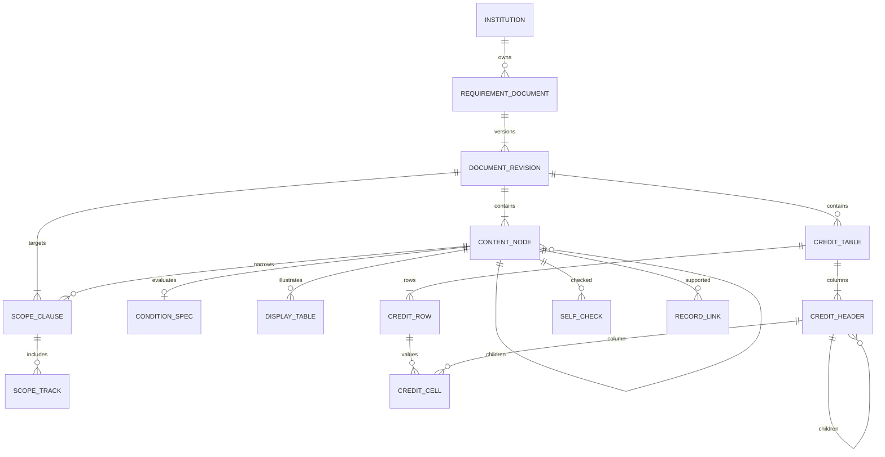

# 졸업요건 데이터 모델 재설계안

> 구현 전 설계안이다. 한 줄 요건·학점표·인증 요건의 현재 관리자 계약은
> [현재 구현](api/admin-academic-workspace.md)을 따른다. 학생 O/X·개인 기록·평가는 후속이다.

- 작성: 2026-11-08 KST
- 상태: 검토용 제안. 현재 DB·OpenAPI·실행 서버 계약을 변경하지 않는다.
- 조사 기준: 제품 `develop` 288af01, 학교 분류 후속 작업 b765272의 문서·편집기. 설계 문서는 develop 기반 별도 브랜치에서 작성했다.
- 목적: 학교별 규정을 한 줄 요건·인증 요건·학점표로 작성하고, 해당 학생에게 적용되는 기준을 전달한다.
- 이번 범위: 기존 구조 대조, 논리 ERD, 제약·버전·연결·이전·후속 API 요구사항 설계. 화면·백엔드·Rule Engine·마이그레이션 구현 및 운영 DB 조회는 하지 않는다.
- 아래 영문 엔터티·필드는 논리 설계명이다. 사용자 요청으로 전체 범위는 DB·OpenAPI 변경까지 확장됐으며, 테이블·컬럼·제안 경로는 [DB·API 변경 명세](academic-schema-api-proposal.md)에서 구체화한다. 현재 단계에서 실제 코드는 변경하지 않았다.
- 범위 확장: 학교·학과·교육과정·과목·학교별 분류도 함께 재설계한다. 공통 기준 관계는 [학사 기준 통합 설계](academic-catalog-data-design.md)를 따른다. 본문 모델은 이 문서에서 관리한다.
- 현재 구현 범위는 관리자 학교·학과/교육과정·과목/졸업요건 세 메뉴와 필요한 DB·백엔드·관리자 API다. 아래 학생 체크·개인 기록·평가 모델과 학생 수용 기준은 후속 참고이며 이번 migration/API/화면 구현에서 제외한다. 현재 완료 기준은 관리자 저장·재조회·수정·게시/철회다.

## 1. 사용자 결정과 제안의 구분

### 확인된 방향

- 관리자 구조를 먼저 정리하고 학생 화면은 이후 재설계한다. 현재 학생 화면은 보존한다.
- 한 줄 요건은 규정 문장을 입력하고 학생이 각 문장에 O/X를 직접 표시하는 용도다.
- 인증 요건은 영역별 조건, 학점표는 학교 문서 같은 표를 표현한다. 기존 편집기로 가능한 것은 유지하고 부족한 것만 보완한다.
- 특정 학교의 영역명·과목 분류·이수 경로를 제품 고정값으로 만들지 않는다.
- 한 줄 요건의 출처 URL 입력은 제거한다. 기존 출처 데이터·공식 문서·실행 근거를 삭제한다는 결정은 아니다.
- 분류 연결 초안은 활용 가치를 검토한다. 모든 편집기에서 일괄 제거하거나 그대로 노출하는 것으로 확정하지 않았다.
- DB·API의 기존 구조를 확인한 뒤 목표 모델과 차이를 설계한다.

### 이 문서가 추천하는 사항

- 공통 적용 범위와 버전 구조를 공유하고, 본문은 세 종류별 구조로 저장한다.
- 별도 규칙 묶음 등록 화면 대신 편집 단위 내부에서 묶음 기능을 활용한다. 이는 UX 제안이며 사용자 확정 결정은 아니다.
- 학생 직접 체크와 기록 연결 기반 결과는 별도 저장한다. 인증의 자동 연결 범위는 후속 계약 확정이 필요하다.
- 표·문장·그룹·항목에는 표시 이름과 분리된 안정 ID를 부여한다.

## 2. 현재 구조와 차이

| 대상 | 현재 구현 근거 | 재사용 | 부족한 부분 |
| --- | --- | --- | --- |
| 학교·학과·교육과정·과목 | `backend/app/models/academic.py` | UUID, 학교 복합 FK, 교육과정별 과목, Decimal 학점 | 학교별 추가 분류 저장·이수 경로 마스터 계약 없음 |
| 규정 메타데이터 | 같은 파일의 `rule_sets`, `graduation_rules` | 학교/학과/교육과정, lineage·revision·version, 기간·적용 이력, 독립 요건 | 입학연도·학생 구분이 실행본에 분리됨. 문장별 안정 ID·순서 없음 |
| 실행본 | `backend/app/models/rule_programs.py`, `schemas/rule_programs.py` | 승인·회수, 버전 충돌, 명시 조건, 근거/과목/자격 마스터 스냅샷 | 다단 학점표·임의 깊이 조건 그룹·어학 점수·면제/대체 구조 없음 |
| 한 줄 편집 | `frontend/lib/features/admin/admin_rule_execution_panel.dart` | 줄 추가·제거, 공통 입학연도 구간·tracks, manual_review 저장 | 여러 줄을 개행으로 합친 instruction 하나로 저장. 전체 500자·32줄 제한. 문장별 범위·정체성 없음 |
| 학점표 편집 | `frontend/lib/features/admin/graduation_credit_grid*.dart` | 자유 행/열, 한 단계 열 묶음, 소수 3자리, 빈칸/숫자/해당 없음, 비고·복사 | 열 묶음 중첩·병합·순서 이동 부족, 저장/학생 조회 미연결 |
| 인증 편집 | `frontend/lib/features/admin/graduation_certification*.dart` | 중첩 그룹, 모두/택 1/택 N, 문장·종류·면제 문구 | 입학연도 없음, 수치/기록 연결·표 형태 보충자료 없음, 저장 미연결. 택 N 검사는 직계 문장 수만 계산 |
| 학생 체크 | `frontend/lib/features/graduation/official_graduation_page.dart` | instruction 줄별 충족/미충족 버튼 | `_lineMarks` 메모리 상태. 키가 rule ID+문장이어서 동일 문장 중복·문장 수정에 취약 |
| 학생 개인 기록 | `backend/app/models/personal.py` | 소유자 UUID, 기록 버전·수강·활동·자격 데이터 | 수강의 원본 과목/분류 참조 부족. 어학 시험·점수 척도 구조는 새 계약 필요 |
| 학교 감사 | `backend/app/models/graduation.py`, `docs/api/graduation-audits.md` | 불변 규정 검토·본인 감사, 지문·근거·기준일·멱등성 | 자기 체크·자기 입력을 학교 승인 기록으로 사용하면 안 됨. 새 편집 본문과 연결하는 adapter 필요 |

DB 소스의 존재를 운영 마이그레이션 적용이나 API 실동작 확인으로 간주하지 않는다.
`docs/database-erd.md`는 장기 논리 모델도 포함하므로 현재 구현은 모델·schema·OpenAPI와 대조한다.

## 3. 공통 모델

그림은 주요 관계의 개요다. 조건 참조·표 집계·이력의 보조 관계는 아래에서 정의한다.

| 논리 엔터티 | 기본키와 주요 값 | 소유·참조·용도 |
| --- | --- | --- |
| RequirementDocument | id, institution_id, kind, lineage_id | 학교 안의 편집 단위. kind는 한 줄/인증/학점표의 닫힌 종류. 기존 RuleSet 등과의 물리 통합은 이전 설계에서 결정 |
| DocumentRevision | id, document_id, revision, lock_version, status, effective_from/to, title, content_digest | draft→published→withdrawn, 게시 후 본문 불변. 상태명은 제안이며 기존 applied/approved와 구별 |
| ContentNode | id, revision_id, logical_id, parent_id, position, node_type, text | 한 줄 문장, 인증 group/item의 순서 트리. 학점 셀은 별도 표 구조로 저장 |
| ScopeClause | id, revision_id, node_id?, credit_row_id?, department_id?, curriculum_id?, admission_from/to?, track_mode | 문서 공통 범위 필수, 문장/그룹/표 행은 선택적 축소. 학교는 revision에서 결정 |
| ScopeTrack | clause_id+track_id | 학교별 안정 경로 ID 집합. track_mode=all/selected, selected만 1개 이상 |
| ConditionSpec | id, node_id UNIQUE, kind, schema_version, payload, fingerprint | 문장과 별개인 닫힌 타입의 조건. schema 검증 JSONB와 참조 FK를 병용. 자유 수식을 실행하지 않음 |
| SelfCheck | owner_id+revision_id+logical_node_id, mark, version, updated_at | mark=O/X/미확인. 행이 없으면 미확인. 문서 버전과 본인에 속하는 직접 확인 |
| RecordLink | id, owner_id, revision_id, node_id, record_kind, typed_record_ref, observed_version, purpose | 본인 기록의 명시 연결. 지원 타입만 허용하고 실제 FK/타입별 자식 테이블로 존재·소유자 검증 |

node_type은 한 줄 문장/인증 그룹/인증 항목의 닫힌 종류다. 문서 kind와 맞지 않는 노드를 거부한다.
ContentNode의 (revision_id, logical_id)는 UNIQUE이며 SelfCheck가 해당 쌍을 FK로 참조한다.
revision은 document 안에서 유일하고, ContentNode의 parent는 같은 revision만 참조한다.
논리 ERD의 CONTENT_NODE→SCOPE 관계는 선택 관계이며 실제 ScopeClause는 node와 표 행을 동시에 소유자로 가질 수 없다.

## 4. 적용 대상의 의미

- 같은 clause 안의 학과·교육과정·입학연도·경로는 AND, 여러 clause는 OR다. A학과/2026과 B학과/2025를 두 행으로 지정하면 A/2025가 섞이지 않는다.
- 학과가 없으면 학교 공통, 교육과정이 있으면 해당 학과와 학교에 속해야 한다. 연도 제한 없음은 명시적으로 저장하며 빈 입력을 임의로 현재 연도로 채우지 않는다.
- 경로 전체는 `all`, 특정 경로는 `selected`로 명시한다. 빈 목록으로 전체/미설정을 중의적으로 표현하지 않는다. 학교 분류 마스터 계약이 선행 조건이다.
- 하위 요건의 범위는 문서 범위와 교집합이다. 부모 범위를 넓히는 override는 지원하지 않는다. 하위 clause가 없으면 상속하고, 교집합이 비면 게시를 막는다.
- 인증의 공통 적용 대상, 그룹의 예외 대상, 학점표 행의 경로 범위도 같은 판별 규칙을 사용한다. 행/노드별 물리 scope 관계는 명시 FK를 사용하며 `target_type + target_id`만으로 참조하지 않는다.
- 학생 문맥에서 제한된 필드가 누락되면 `확인 필요`다. 전체 대상으로 간주하거나 해당 규정을 숨기지 않는다. 필요한 추가 프로필 항목을 반환한다.
- 적용 대상은 학생의 선택 프로필 문맥이다. 프로필에 포함됐다는 사실로 공식 학적을 인증하지 않는다. 공식 감사는 기존 학교 검토 자료 경로를 유지한다.
- 직장인·외국인·편입생 등이 같은 축인지 학교마다 다르다. 이를 모두 단일 track의 상호배타 값으로 강제하지 않는다. 1차는 기존 학과/교육과정/입학연도/경로, 추가 학생 구분은 별도 학교별 대상 속성 계약이 정해진 후 도입한다. 미지원 예외는 문구와 수동 확인으로 남긴다.
- 학교 공통·학과·교육과정 규정은 합쳐 적용한다. 구체적인 범위가 있다고 공통 규정을 자동 대체하지 않는다. 대체는 명시 연결로만 처리한다.

## 5. 한 줄 요건

- 문장 1개는 ContentNode 1개다. 제목은 편집 단위에만 선택적으로 두고 문장마다 관리용 제목·종류·설명을 중복 요구하지 않는다.
- 문장 text, position, 안정 logical_id, 공통 범위 상속/축소가 핵심이다. 순서 변경으로 ID를 재생성하지 않는다.
- 문장에 줄바꿈이 있어도 문장 분할 기준으로 쓰지 않는다. 내용 개정과 문장 추가/삭제를 구별한다.
- 출처 URL을 필수/선택 입력으로 새로 요구하지 않는다. 기존 URL·공식 문서·근거 참조는 구버전에 보존한다.
- 문장별 한도와 문서 전체 바이트·항목 한도를 분리한다. 현재 전체 500자 제한을 그대로 새 모델의 정책으로 채택하지 않는다. 실제 학교 문서량으로 서버 한도 확정이 필요하다.
- 학생 체크는 문장 텍스트가 아닌 stable ID+revision에 묶는다. 직접 O/X가 공식 감사 결과를 덮어쓰지 않는다.
- 문장/대상/확인 의미가 바뀐 새 revision은 미확인으로 시작한다. 변경 없는 문장의 체크 승계는 의미 fingerprint가 동일할 때만 명시 정책으로 허용하는 후속 기능으로 둔다. 1차 기본은 새 버전 재확인이다.

## 6. 인증 요건

- group과 item을 같은 순서 트리에 두어 문장·하위 그룹을 섞어서 배치/이동한다. parent는 같은 revision의 group만 가능하고 순환을 금지한다.
- group 연산은 all / at_least(k)를 제안한다. UI의 택 1은 at_least(1), 택 N은 at_least(N)이다. 정확히 N만 인정하는 학교 규정은 별도 exact 정책 검토 전 자동 지원으로 표시하지 않는다.
- 개수는 직계 자식인 item과 group 모두를 센다. 면제/대체/설명 블록은 개수에 포함하지 않는다. 비어 있는 그룹과 범위를 벗어난 k는 초안에 보존하되 게시를 막는다.
- 부분 미확인, 미충족, 면제, 해당 없음은 별도 상태다. 모두 미확인인데 자동 O가 되거나 면제된 항목을 충족 개수로 자동 가산하지 않는다.
- 인증 종류를 선택했다고 자동 판정하지 않는다. 각 item은 직접 확인 또는 명시 조건과 연결 가능한 기록 종류를 가진다.

| 조건 | 필요한 값/참조 | 기존 계약 활용과 부족분 |
| --- | --- | --- |
| 직접 확인 | 학생 확인 문구 | manual_review 개념 재사용, 문장별 체크 저장 신설 |
| 자격 취득 | 자격 마스터 ID·허용 대안·유효성 정책 | any_certificate 참조 재사용, 개인 자격/마스터 연결 부족 |
| 봉사시간/학점 | 최소값, 단위, 집계 대상·기간·분류 참조 | 기존 최소값 조건 일부 활용, 학교별 분류·중복 산입 정책 확장 |
| 어학 점수/성적 | 시험/척도 ID, 비교 연산·값 또는 등급 집합, 유효기간 | 새 구조 필요. TOEIC와 TOEFL 점수를 숫자 크기로 비교하지 않음 |
| 활동/교육·서류 | 대상 종류, 완료/제출 등 관찰값과 확인 출처 | 기존 개인 기록 존재 여부와 별도. 지원하지 않는 판단은 직접 확인 |

- 조건 payload는 kind별 닫힌 schema로 검증한다. 마스터 참조는 관계 테이블에 FK·검토 버전을 보존한다. JSON 안 UUID만 넣어 참조 무결성을 대신하지 않는다.
- 면제는 `어떤 대상을 / 어떤 요건에서 / 어떤 조건으로 면제`하는지 연결한다. 문자열 이름 비교는 사용하지 않는다. 대체 요건은 대체하는 node와 같은 revision의 대체 조건을 명시하며 순환을 거부한다.
- 논리 ExceptionRule은 id, revision_id, target_node_id, kind(exemption/replacement), scope, condition_id?, replacement_node_id?, position, explanation을 가진다. exemption에는 대체 노드가 없고 replacement에는 같은 revision의 유효한 대체 노드가 필수다. scope와 조건이 없는 무조건 면제는 게시 시 명시 확인을 요구하며, 미지원 조건을 참으로 채우지 않는다. ExceptionRule은 같은 범위 모델을 사용하는 전용 FK 관계를 둔다.
- 면제/대체가 그룹 평가에 미치는 의미는 게시 시 고정한다. 명시적 면제는 별도 exempt 상태로 그룹 충족을 처리할 수 있지만 상위 택 N의 선택 개수 산입은 별도 정책으로 정의한다. 자동 정책이 없으면 확인 필요다.
- 캡처의 어학 점수표 등 보충자료는 DisplayTable로 표현한다. table(id,node_id), row/column(id,position,label), cell(row_id,column_id,text) 관계이며 행·열은 같은 table FK를 가진다. 설명 표의 숫자를 자동 판정 조건으로 해석하지 않는다.
- 점수표와 ConditionSpec이 다른 내용을 가리키면 검토 경고·게시 확인 대상으로 남긴다. 조건을 자동 생성하는 후속 기능은 현재 범위가 아니다.

## 7. 학점표

| 엔터티 | 주요 값·제약 |
| --- | --- |
| CreditTable | id, revision_id, title, position. 하나의 revision 안 여러 표 허용 |
| CreditHeader | id, table_id, parent_id?, position, label, role(group/value/subtotal/total). 같은 표의 트리, 자식 있는 header는 값 셀 금지 |
| CreditRow | id, table_id, position, label, note, 적용 범위 참조. 행 이름은 자유 입력, 대상 경로는 안정 참조 |
| CreditCell | row_id+leaf_header_id, table_id, state, numeric_value. state=empty/number/not_applicable, number만 Decimal 값 허용 |
| CreditColumnBinding | header_id, 학교 분류/category/subcategory 참조, 필수/선택 조건. 학교 분류 계약과 공동 확정 |
| CreditAggregateMember | subtotal_header_id+member_header_id. 명시 집계 관계, 같은 표, 순환·자기 참조 금지 |

- `교양 → 필수 → 기초교양/공통교양/기초과학/외국어`, 그 옆 `선택·소계`처럼 임의 깊이 열 트리를 지원한다. 학교별 이름은 고정하지 않는다.
- 미리보기의 머리글 병합은 트리의 하위 잎 개수와 깊이로 계산한다. 병합된 이름과 실제 분류 ID는 별개다. 같은 학과를 매 행 반복할지 묶어 표시할지는 표시 속성으로 둔다.
- 표 자유 셀 병합을 먼저 일반 스프레드시트 수준으로 구현하지 않는다. 임의 병합이 필요한 학교 사례가 나오면 표 구조·키보드 접근성까지 추가 설계한다.
- 소계·최소 졸업학점은 문서 기재값으로 저장한다. 집계값과 불일치하면 경고하며 원문 숫자를 덮어쓰지 않는다. 전체 최소값은 하위 최소값들의 단순 합과 같다고 가정하지 않는다.
- numeric_value는 Decimal 계열로 소수 3자리까지 허용한다. 정밀도·전체 학점 상한은 개별 과목의 기존 0~100 제한과 별개로 정한다. 빈칸·0·해당 없음을 보존한다.
- 복사는 신규 문서/revision·행/열 ID를 만들고 학교 분류 참조를 보존한다. 학생 체크·기록 연결·게시 상태를 복사하지 않는다. 연도와 숫자를 유지할지 비울지는 복사 옵션으로 명시한다.
- 과목 분류 연결은 학점 산입을 위한 매핑이다. 학생에게 전달할 범위와 분리하고 필요한 잎 열에서만 편집한다. 표시 이름으로 자동 연결하지 않는다.
- 동일 이수학점의 중복 산입, 재수강, 대체 과목, 복수전공 중복 인정은 별도 집계 정책이다. 기존 Rule Engine이 지원하지 않는 정책은 수동 확인으로 남기며 표의 모양만으로 계산하지 않는다.

## 8. 버전·무결성·권한

- 편집 잠금용 lock_version과 게시 revision을 분리한다. draft 수정은 expected_version으로 충돌을 검출하고 게시본은 새 revision으로만 변경한다.
- 게시 트랜잭션은 본문·범위·참조 버전을 함께 검증하고 하나의 내용 지문을 만든다. 부분 저장 성공과 게시 성공은 구분한다.
- 다른 규정은 같은 범위에 누적 적용 가능하다. 동일 lineage의 두 현재 게시본이 같은 대상·기간을 덮는 경우는 교체 관계를 명시하거나 게시를 거부한다. 복수 clause/경로의 겹침 검사는 단일 UNIQUE만으로 충분하지 않아 서비스 잠금·트랜잭션 검사가 필요하다.
- 모든 내용 FK는 revision/table/학교를 함께 검증한다. 트리 순환·깊이/개수 상한은 서비스 검증, 순서 UNIQUE와 양수 version·연도/기간 순서는 DB 제약으로 보강한다.
- position 재정렬은 같은 부모 단위 트랜잭션으로 처리한다. root의 NULL parent도 순서 중복이 발생하지 않게 부분 UNIQUE 또는 별도 root 컨테이너를 쓴다.
- ScopeClause의 소유 대상은 문서/node/표 행 중 정확히 하나다. 학교 복합 FK를 유지하고 부모 범위 축소 검사를 게시 시 수행한다.
- CreditCell은 row와 header가 같은 table이어야 한다. `number`는 0 이상, 나머지는 numeric_value NULL이다. FK로 leaf 여부가 표현되지 않으면 서버 게시 검증/trigger 대안을 물리 설계에서 확정한다.
- 학생 쓰기는 로그인 본인 SelfCheck·RecordLink만 허용한다. owner_id는 요청으로 신뢰하지 않으며 기록 참조는 같은 소유자 복합 FK로 검증한다. 관리자 학교 권한이 개인 기록 열람 권한을 주지 않는다.
- SelfCheck는 optimistic version, RecordLink는 관찰 당시 record version과 결과 기준일을 가진다. 기록이 바뀌거나 철회되면 현재 결과는 재확인 대상으로 표시하고 과거 결과를 덮어쓰지 않는다.
- 평가 결과는 기존 감사와 구분된 자기관리 결과다. 기존 불변 감사 패턴을 재사용하되 actor, revision 지문, 입력 기록 ID/버전, 계산기 버전, 기준일을 보존한다. 학교 감사 테이블에 자기 체크를 섞지 않는다.
- 논리 EvaluationSnapshot은 id, owner_id, client_id, context_snapshot, as_of, calculator_version, requirement_revision_refs, input_record_refs, result_payload, digest, created_at을 가진다. owner_id+client_id는 UNIQUE이며 동일 키·다른 본문은 충돌이다. 자기관리 결과의 근거 종류(self_check/personal_record/school_reviewed_record)를 명시하고 서로를 자동 승격하지 않는다. 공식 감사와의 공유 구현 범위는 백엔드가 결정한다.
- 조회 인덱스 후보: document(학교,종류), revision(document,status), scope(학교,학과,교육과정,입학연도 구간), track(clause,track), node(revision,parent,position), SelfCheck(owner,revision), RecordLink(owner,node). 실제 인덱스는 조회 계획 확인 후 확정한다.

## 9. DB와 API 경계 / 백엔드 협의용 요청

기존 API 경로는 `docs/api/academic.md`, `rule-programs.md`, `graduation-audits.md`와 OpenAPI가 기준이다. 아래는 필요한 동작이며 새 경로나 enum을 확정한 것이 아니다.

| 동작 | 요청/반환에 필요한 의미 | 실패·수용 조건 |
| --- | --- | --- |
| 관리자 초안 저장/재조회 | 타입별 전체 본문, 안정 ID·순서·범위·참조, expected_version, 재시도 ID | 충돌은 409. 응답 유실 후 재조회/동일 키 재시도로 중복 생성 방지 |
| 게시 미리보기·게시/교체 | 범위별 적용 목록, 누락/모순, 예상 지문, 검토 확인 | 미리보기 후 변경 시 거부. 원문/실행 조건/분류 불일치와 미지원 정책을 구별 |
| 해당 학생 기준 조회 | 프로필 문맥·기준일, 일치 revision·상속 후 범위·조건·표, 미확인 대상 필드 | 범위 불명은 전체/없음으로 오인하지 않음. 학교 공통+학과 기준 누락 없음 |
| 본인 문장 체크 | 안정 문장 ID·revision·O/X/초기화·expected_version | 다른 학생 접근 불가, 구버전 체크를 새 버전에 자동 적용하지 않음 |
| 본인 인증 기록 연결 | 지원 record kind·ID·버전, 비교값·척도·기간, 명시 동의/선택 | 소유자·유효성 검증. 기록 없음/미확인/미충족/면제 구별 |
| 분류 마스터/과목 연결 | 학교별 안정 ID·버전·사용 상태, 과목 기본값과 교육과정별 적용 우선순위 | 다른 채팅의 학교 분류 계약과 통합. 별도 마스터를 중복 생성하지 않음 |

오류는 기존 envelope·field_errors·request_id를 유지하고 node/row/cell ID에 대응 가능한 입력 위치를 제공해야 한다. 목록은 페이지네이션하고 부분 조회 결과를 전체 규정으로 표현하지 않는다.
기존 설명 저장→적용→실행본 저장 순서는 API 내부에서 유지할 수 있으나 사용자에게 중복 폼을 요구할 필요는 없다. 원자적 저장 지원 여부·부분 실패 복구·검토 단계는 새 계약에서 확정한다.

## 10. 이전·호환 순서

1. 새 구조를 추가하고 기존 graduation_rules/rule_sets/programs/audits를 읽기 호환으로 유지한다. 기존 테이블 파괴·운영 데이터 변경은 이번 작업에 없다.
2. 기존 manual_review의 instruction을 개행 분할해 후보 문장 ID를 만들되, 동일 문장도 별개 ID를 부여한다. 기존 표시처럼 빈 줄만 제외한다. 관리자가 범위/분할 결과를 확인한 새 초안으로 옮기고 자동 게시하지 않는다.
3. 규칙 묶음은 편집 단위와의 legacy 매핑을 검토한다. 기존 묶음과 문서 타입/버전의 의미가 다르므로 1:1이라고 단정하지 않는다. 독립 규칙도 손실 없이 이전한다.
4. 현재 학점표·인증은 저장 서버가 없고 편집 state에 존재한다. 복구할 서버 원본이 있다고 가정하지 않는다. 남아 있는 실제 기기 초안의 내보내기·동의 이전 가능 여부부터 확인한다.
5. 경로 문자열→학교별 ID는 명시 대응표로 이전한다. 동명 분류를 자동 병합하지 않는다. 대응 불가 값은 원본 보존·확인 필요로 둔다.
6. 기능별 새 조회/편집을 전환하고 구버전은 읽기 호환한다. 기존 공식 감사·근거 지문·이력 payload는 재작성하지 않는다. adapter 불가 조건은 표시만 유지하거나 수동 확인으로 명시한다.
7. 별도 운영 백업·리허설·rollback 절차를 확정한 뒤에만 실제 migration을 실행한다. 이 문서는 실행 승인이 아니다.

## 11. 사례별 수용 기준

- 한 줄 요건: 캡처의 7개 문장을 별개 ID로 등록·재조회·순서 이동할 수 있다. 7번째 면제 안내도 원문 문장으로 보존하며 자동 면제로 해석하지 않는다. 적용 학생만 조회되고 동일 문장 두 개의 체크가 충돌하지 않는다.
- 인증: 창의영역 아래 정보화/세계화/인성·봉사/취업·창업을 만들고 선택 조건을 정확한 수준에 지정한다. 세계화 내부 시험별 점수표를 표현하고 각 시험의 척도를 독립 보존한다. 빈 기준·하위 그룹만 있는 택 N의 개수 검사가 일관된다.
- 학점표: 교양→필수→4개 잎 열과 선택/소계, 전공 필수/선택/소계, 기타/최소학점/비고를 표현한다. 단일·복수·부전공·직장인·외국인 행의 숫자와 공란을 보존하고 각 행의 대상 의미를 임의로 추론하지 않는다.
- 학교 범용성: 다른 학교가 상이한 이름·깊이·경로·인증 묶음을 사용해도 코드의 학교별 분기 없이 입력 가능해야 한다. 지원하지 않는 자동 계산 정책은 명시하고 원문 작성은 보존한다.
- 범위: 학교 공통+학과별을 누적하고, A/2026·B/2025의 OR에서 A/2025가 일치하지 않는다. 프로필 정보 누락은 확인 필요다.
- 개정: 게시본 수정 차단, 새 버전 작성·기간 교체·동시 저장 충돌·재시도 멱등성·과거 체크/판정 재현을 확인한다.
- 권한: 타 학교 분류·타인 기록 연결을 거부하고, 관리자도 본인 이외 SelfCheck/개인 기록을 일반 학교 권한으로 조회하지 못한다.

## 12. 권장 착수 단위와 남은 결정

1. 학교·학과 정체성과 학교별 분류/경로 마스터 저장·조회를 먼저 설계한다.
2. 교육과정 적용 대상·버전과 과목 편입·분류를 정리하고, 졸업 규정의 공통 범위와 같은 기준을 사용한다.
3. 한 줄 요건의 문장 ID/순서·본인 O/X 저장 계약과 관리자 편집 흐름을 정리한다. 출처 URL·분류 연결 초안의 일괄 입력을 필수 절차로 두지 않는다.
4. 학점표의 열 트리·행·셀·분류 매핑 저장/조회를 확정하고 편집기 부족분을 보완한다.
5. 인증의 조건 그룹·설명 표를 저장하고, 개인 기록 연결은 실제 지원 가능한 종류부터 후속 연결한다.
6. 관리자 구조가 안정된 뒤 학생 화면을 재설계한다.

구체 설계에서 정리할 사항: 기존 metadata/program과 새 편집 문서의 호환, 학교별 경로/추가 대상 속성 마스터, scope 교집합·게시 겹침 검사, 조건별 기록 출처·단위/척도·집계 정책, 의미 변경 시 재확인, 새 한도·부분 실패 복구·기존 데이터 이전 매핑이다. DB·OpenAPI 변경은 사용자 요청으로 이번 전체 작업에 포함하며 구현 전 단계적 계약을 확정한다.

검증: 저장소 모델·schema·API 문서·프런트 편집/체크 코드와 대조한 설계 검토다. 실행 DB·실제 API 호출·화면 렌더·마이그레이션·부하 테스트는 수행하지 않았다.
